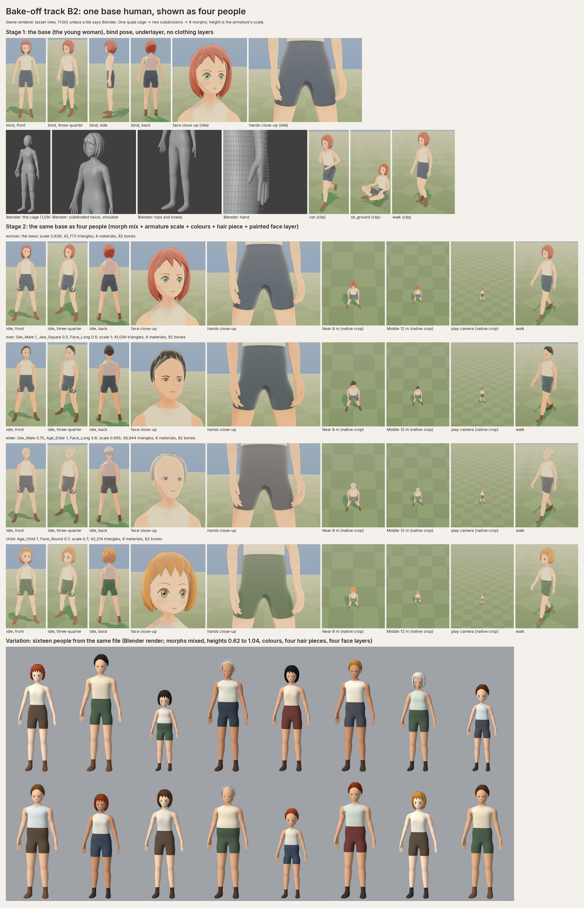

# Bake-off track B2: one base human, shown as four people

Track B2 of the character bake-off (dev-box, 2026-11-26; brief in `~/.local/state/bakeoff/BRIEF.md`, changed mid-session by the owner to "a solid human shape first, then edit it for variety; no clothing layers"). Made with Blender 5.2.2 from scripts, judged in the game's renderer.



## What is here

| File | What it is |
| --- | --- |
| `base.py` | Builds the base: the quad cage from parameters, the weights, the eight morphs, the face layer, and one GLB and `.blend` a person. |
| `hair.py` | Hair as a separate piece: a scalp cap and broad tapered locks over the skull's ellipsoid; four styles. |
| `facetex.py` | Paints the face layer's picture (eyes, lashes, brows, nose mark, mouth, blush, freckles, lines; shut eyes and open mouth in the lower strip). |
| `preview.py` | Blender stills of a saved master: views, wire, the cage, a clip's frame, an expression. |
| `variety.py` | Sixteen people from `b2-base.blend` (morphs mixed, heights, colours, hair, face layers). |
| `sheet.py`, `shoot_all.sh` | The contact sheet; one command that builds, photographs and lays out everything. |
| `b2-base.blend` | The master: `BaseCage` (1,094 vertices, the eight shape keys, a Subdivision modifier at 2) in the collection "Master cage", the baked `Body` with the same keys, `FaceLayer`, `Hair`, and the armature with its six clips. |
| `face-*.png` | The four painted face layers, 1024x1024 RGBA. |
| `report.json` | Triangles, materials, bones, clips and morph mix of each file, written by `base.py`. |
| `contact-sheet.jpg` | All four people in the game's renderer, the topology, the clips and the variation. |

The GLBs (2.0 to 3.2 MB each) and the other `.blend` files are not committed; `shoot_all.sh` writes them to `.local/b2/out/` (`b2-woman.glb`, `b2-man.glb`, `b2-elder.glb`, `b2-child.glb`, and `b2-base.glb` with every morph target).

```bash
docs/char-bakeoff/B2/shoot_all.sh        # about two minutes; needs the game built in CARGO_TARGET_DIR
```

## Stage 1: the base

- **One cage, all quads but the poles** (head top, finger and toe tips). Torso and head are rings of 16; arms and legs rings of 10, with three rings at each elbow and knee; an armhole of 10 edges takes the arm's ring, and the hip ring splits into the legs round one crotch vertex; fingers are tubes of four from a web ring, the thumb leaves the palm's edge. Two Catmull-Clark subdivisions give the game mesh: 35,424 triangles for the body.
- **Bind pose** is the skeleton's own: a narrow A (arms 17 degrees off the body). It was not re-posed to a wider A.
- **Underlayer, not clothing layers:** a sleeveless top, shorts and soft shoes are material regions of the body's own mesh, each its own material so its colour is a parameter.
- **Weights:** Blender's bone heat, solved on a stand-in rig whose bones run joint to joint (the imported bones' tails point anywhere and gave broken weights), on the cage, so the subdivision smooths them. Head, neck, hands and fingers are written by rule.
- **Face:** the head is a loft with a tapered jaw and a small nose, lip and chin added after subdivision. Eyes, lashes, brows, mouth, blush and freckles are painted on a thin layer 0.7 mm over the face's front (`M00_000_00_FaceTint_00_FACE`, which the client draws unshaded). `Fcl_EYE_Close` and `Fcl_MTH_A` swap in patches with shut eyes and an open mouth that lie 1.2 mm under the skin.
- **Painted shade** is in the vertex colours (warm knees, elbows, knuckles and fingertips; soft dark under the jaw, in the armpits and the crotch; a waistband and a hem line; soles), so the materials' colours stay free.

## Stage 2: the same base as four people

Every morph is the cage built again with other parameters, so all share topology, weights and UVs: `Sex_Male`, `Age_Child`, `Age_Elder`, `Build_Heavy`, `Build_Slim`, `Face_Round`, `Face_Long`, `Jaw_Square`. Height is the armature's scale, since every bone scales with it.

| Person | Morph mix | Scale (height) | Triangles | Hair | Face layer |
| --- | --- | --- | --- | --- | --- |
| woman (the base) | none | 0.9265 (1.69 m) | 42,772 | bob, side fringe | green eyes, freckles |
| man | `Sex_Male` 1, `Jaw_Square` 0.5, `Face_Long` 0.5 | 1.0 | 41,036 | short, brushed fringe | narrow brown eyes, heavy brows |
| elder | `Sex_Male` 0.75, `Age_Elder` 1, `Face_Long` 0.6 | 0.955 | 39,944 | receding, grey | lines, moustache |
| child | `Age_Child` 1 (head x1.3), `Face_Round` 0.7 | 0.70 | 42,214 | bob, straight fringe | large eyes |

Each file: 6 materials (`M00_000_00_Body_00_SKIN`, `B2_UnderTop_CLOTH`, `B2_UnderShorts_CLOTH`, `B2_Shoes_CLOTH`, `M00_000_00_FaceTint_00_FACE`, `M00_000_Hair_00_HAIR`), one 1024x1024 texture (the face layer; everything else is a colour and vertex colours), 82 bones, six clips (`idle`, `walk`, `run`, `talk`, `sit_idle`, `sit_ground`). The four people's files have their mix baked in and carry only the two expression targets; `b2-base.glb` carries all eight morph targets on the body.

**What varies:** the eight morphs (any mix), height, four colours of the underlayer and skin, the hair piece and its colour, and the face layer's parameters (`facetex.py` `SPECS`: eye size, tilt and place, iris, lash and brow colours and weights, mouth, blush, freckles, lines, moustache). For a town of 64: the body and face layer are one mesh for everyone, so a person is a weight vector, a scale, a hair file and a 1024 picture (or a tile of a shared page).

## Skeleton

The armature is the one in `docs/char-live-2/final/own-cora-live.glb` (Cora's master), with its six clips. Its 81 `J_*` joints have the same names as the nodes of `lookdev/anim/own-clips.glb`, and that file keys 52 rotations and the hips' translation, so its clips address these bones by name. Not tested: the client playing the shared 87 clips on these files. The rest places are Cora's figure, not the clip file's standard man (the neck differs by 7.8 cm, the shoulders by 7.0 cm at scale 1), and the clip file rests in a T pose where this skeleton rests with the arms down. The builder's joints are constants read from this armature; building on the standard skeleton means reading them from that file instead.

## What was driven

- All four people and the base file through `~/.local/state/bakeoff/shoot.sh` (the shared shots) and `living/tools/view_assets.sh` (full figure, bind, `run` and `sit_ground`). Stills are in `.local/b2/shoot`, `.local/b2/full`.
- In Blender: wire and cage stills, `run`, `sit_ground` and `talk` frames, the two expressions, the sixteen-person sheet.
- Not driven: the game driving the blink and the mouth (the asset view logged no face rig for a plain file with clips; the expressions were seen in Blender only); the shared clip file on these bodies; a recipe or the composed client path; a far model; performance.

## Weak points

- The face is painted, not modelled: no lids, sockets or mouth interior, and the head's loops are a lathe, not loops round the eyes and mouth. The blink and the open mouth are swaps, with no half-way state.
- The body is smooth and plain: no collarbones, no modelled knees or elbows beyond a ring and a tint, feet are shoes without toes.
- Hair is one authored style a person and rigid on the head bone (no spring bones); the man's and the elder's are the weakest.
- 40 to 43 thousand triangles a person is a close-up density. One subdivision instead of two gives about a quarter, with the same weights and morphs; it was not built or photographed here.
- The child is the adult skeleton scaled, so limb proportions are an adult's with a larger head.
- Skin tones were only tried from light to tan; the face layer's line colour is fixed in `facetex.py`.
- The man reads young.

## Licences

Everything is generated by these scripts. The skeleton and clips are the repository's own (`docs/char-live-2`). No outside meshes, textures or images. The owner's reference images were read from `~/archive/owner-quality-refs-20261126/` only and are not in this branch.
