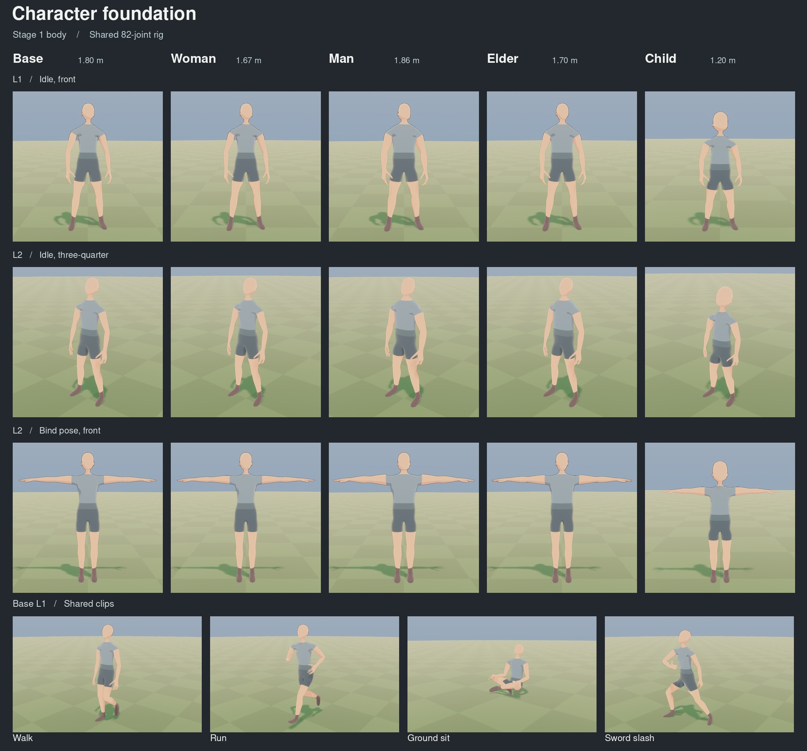

# Stage 1 body

The foundation is derived from our B2 ring cage. The generator reads rest landmarks from the pinned game's joint-only clip GLB and writes a skinned body with its 87 takes. The head is a blank volume for judging proportions. The underlayer colours label regions of the same surface.

From the repository root, with the dev-box build tools on PATH:

```bash
export PATH="$HOME/.local/share/slop-tools/build-bin:$PATH" JOBS=3
blender -b -t 3 --python-exit-code 1 -P living/tools/blender/found/body.py -- \
  living/game/assets/view/char-found/man-l1.glb --preset man --level 1
```

Choose `base`, `woman`, `man`, `elder`, or `child`. Use `--height` for final bind height in metres, `--build` from −1 to 1 for slim/heavy, and repeat `--weight Name=0.5` to override a preset target. `--level 1` and `--level 2` apply Catmull–Clark subdivision to the same cage, weights and target shapes. `--rig` selects another copy of the shared library.

| Target | Change |
|---|---|
| Sex_Male | Wider shoulder caps, deeper ribcage, thicker neck and upper arms, narrower hips |
| Age_Child | Shorter upper/lower limbs relative to trunk, larger cranium, softer jaw, reduced chest |
| Age_Elder | Upper back depth, chest, muscle volume and waist |
| Build_Heavy, Build_Slim | Girth at torso, limbs and neck |
| Face_Round, Face_Long, Jaw_Square | Placeholder head proportions |

The generator keeps joint names, parents, local rest translations, and source animation tracks. A scene parent sets height. The child mix also sets uniform scales at the upper legs and upper arms and scales hips travel by the leg-length ratio through the armature parent, with a reciprocal scale at the hips to preserve trunk size. Generate again when changing child proportions so the rest pivots follow the surface. Other body shape changes use standard glTF morph weights.

## Provenance

The geometry is project-generated from parameters. The B2 cage was authored on `bakeoff-B2` at `2fd3cc1249e8a6d5e1d6b4c8464ec6aa9c6b425a`. The only rig and animation input is the project's pinned `lookdev/anim/own-clips.glb`. The six flat material regions require no texture files.

## Export and playback evidence

All ten files contain six materials, 82 skin joints and eight morph targets. Counts and height below come from the written GLBs, after applying the default morph mix and scene scale. The child's arm span is 0.98 times its height. The base's ratio is 1.06.

| Mix | Height (m) | L1 triangles | L2 triangles |
|---|---:|---:|---:|
| Base | 1.80 | 8,864 | 35,456 |
| Woman | 1.67 | 8,864 | 35,456 |
| Man | 1.86 | 8,864 | 35,456 |
| Elder | 1.70 | 8,864 | 35,456 |
| Child | 1.20 | 8,864 | 35,456 |

- All ten exports preserve the library's animation channels and sampler bytes. The project's `skeleton_check.py` found zero local joint translation differences across the ten exports and the source library. [Export measurements](evidence/exports.json)
- Track A's joint hierarchy, local TRS and animation sampler assertions passed on base L1. Its Blender mesh probe played each of 87 actions. `clips_compare.py` found 0.00° rotation and 0.0 cm translation difference across the 87 takes. `clip_check.py` sampled base L1 every other frame in all 87 clips and child L2 in the four poses below. The lowest surface on base L1 relative to its bind floor was +2 mm in walk, +11 mm in run, +18 mm in sit_ground and −5 mm in sword_slash. [Base report](evidence/clips.json) · [Child report](evidence/child-clips.json)
- The custom parameter entry point was exercised at 1.53 m with `Age_Child=0.4` and build −0.35.

### Deformation

Base L1, posed edge length divided by rest length, fifth through 95th percentile. The measurement covers both sides at every frame, 30 fps. Edges are selected by rest midpoint distance to the joint, as specified in `living/tools/blender/found/strain.py`. A ratio of 1 preserves edge length. [Counts, frames and extrema](evidence/strain.json)

| Clip | Shoulders | Hips | Knees | Hands |
|---|---:|---:|---:|---:|
| walk | 0.68–1.24 | 0.90–1.10 | 0.81–1.29 | 0.94–1.07 |
| run | 0.68–1.24 | 0.86–1.13 | 0.69–1.42 | 0.93–1.08 |
| sit_ground | 0.65–1.25 | 0.50–1.40 | 0.50–1.61 | 0.91–1.11 |
| sword_slash | 0.71–1.21 | 0.87–1.18 | 0.82–1.26 | 0.82–1.29 |

A four-corner saddle between the thighs shares the pelvis and femur weights across the centerline. In a seated frame-20 probe the most stretched edge near the crotch fell from 6.23× to 2.24×. Across the full ground sit the saddle still reaches 0.23× compression and 2.24× stretch, and the knees reach 1.98× stretch. The sword slash has a hand-region outlier at 2.99×. These measurements describe surface distortion. Collision testing and visual acceptance remain separate checks.

To reproduce the regional measurements:

```bash
blender -b -t 3 --python-exit-code 1 -P living/tools/blender/found/strain.py -- \
  "$PWD/living/game/assets/view/char-found/base-l1.glb" /tmp/foundation-strain.json
```

### Game photographs



The photographer uses the dev-box bake-off framing at 1600 × 900, game hour 11. It frames each model independently. The child's reported framing height is 1.281 m because the viewer fits the undeformed mesh bounding boxes. An independent Blender import of the GLB with animations stripped measured the morphed, skinned child bind surface at 1.200 m. The stock Blender clip probe resets local bone scales before playback. Repeating its four child clips with the authored bind transforms restored gives the [child playback measurements](evidence/child-rest-scale-clips.json). Scaling the hips travel reduced the child’s ground-sit floor penetration from 104 mm to 2 mm. For the other four mixes those two heights agree to the shown precision.

The shoulder outline and heavier ribcage distinguish the man from the base. The elder's stoop reads more clearly in profile than from the front. Sleeve roots still form abrupt dark wedges when the arms lower. The calf, ankle and foot volumes read in silhouette, while the front lighting gives little definition to the clavicle. The blank head and inherited B2 fingers are placeholders for later stages.

To reproduce the shared photographs from a fresh output directory on the dev-box:

```bash
export PATH="$HOME/.local/share/slop-tools/build-bin:$PATH" JOBS=3
export CARGO_TARGET_DIR="$PWD/.local/target-char-found" CARGO_BUILD_JOBS=8
models=()
for level in 1 2; do
  for preset in base woman man elder child; do
    model="view/char-found/$preset-l$level.glb"
    blender -b -t 3 --python-exit-code 1 -P living/tools/blender/found/body.py -- \
      "living/game/assets/$model" --preset "$preset" --level "$level" || exit 1
    models+=("$model")
  done
done
# shoot.sh takes the shared build gate around both game invocations.
~/.local/state/bakeoff/shoot.sh "$PWD/.local/tmp/char-found/photos" "${models[@]}"
```
