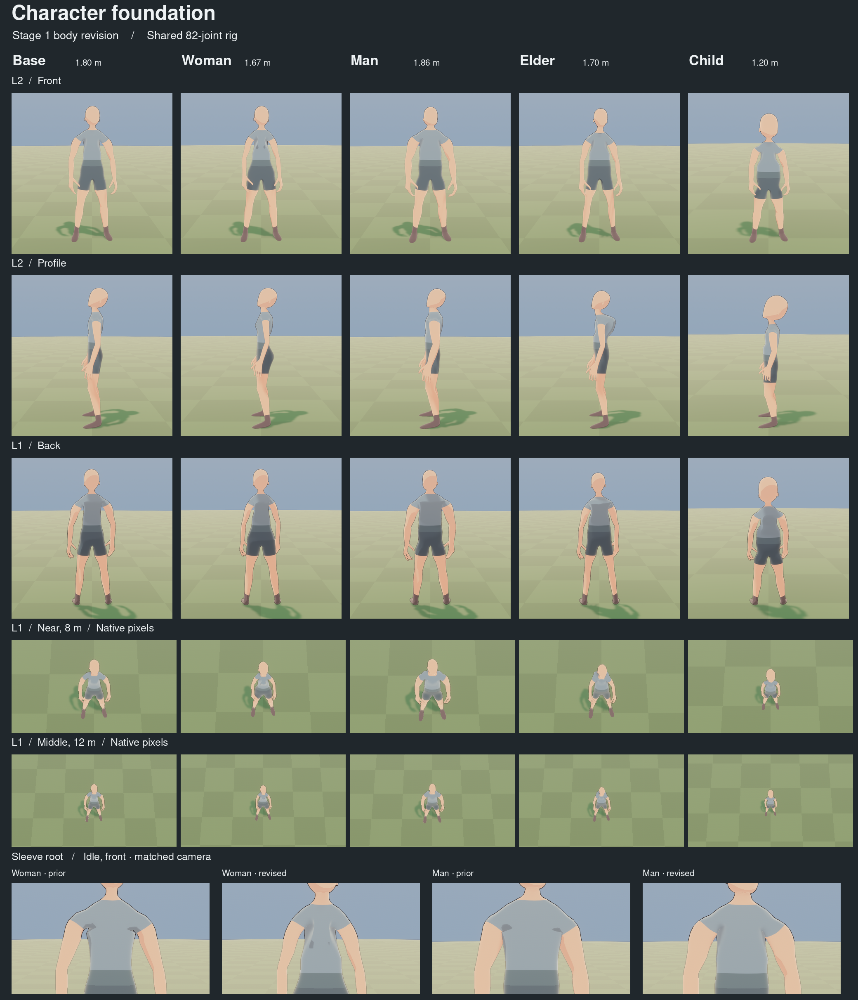

# Character foundation · Stage 1 body



Each column is one body. The upper rows use the shared daylight framing for front and back, with an extra profile for posture. Near and Middle use the same native-pixel center crop for every character. The viewer frames inspection shots individually.

## Generator

From the repository root on the dev-box:

```bash
export PATH="$HOME/.local/share/slop-tools/build-bin:$PATH" JOBS=3
blender -b -t 3 --python-exit-code 1 -P living/tools/blender/found/body.py -- \
  living/game/assets/view/char-found/woman-l2.glb --preset woman --level 2
```

Choose `base`, `woman`, `man`, `elder` or `child`. Supply `--height` in metres, `--build` from −1 to 1, and repeat `--weight Name=value` to override a preset. Both subdivision levels come from the same cage. Each export carries 82 joints, six material regions and nine morph targets. The targets are Sex_Female, Sex_Male, Age_Child, Age_Elder, Build_Heavy, Build_Slim, Face_Round, Face_Long and Jaw_Square. Regenerate when changing shoulder span, age or posture so the skin weights and bind pivots follow the surface.

The female target widens the pelvis and glutes, narrows the clavicles, and shapes the ribcage through the bust and underbust rings. The elder target carries the forward curve from chest to ears, settles the shoulder girdle, and rounds the upper back. The elder preset uses 0.22 Sex_Male. Relative scales on existing joints move the pivots while preserving the library's channels and joint-local translations and rotations. The child has a larger head, narrower clavicles and a softer waist; its shortened long bones and scaled hips travel carry over from the first pass.

The lateral chest wall now reaches the axilla and the first arm ring begins 9 mm beyond the shoulder pivot, measured along the upper arm. A continuous weight transition reaches from the upper chest across the clavicle into the deltoid. The upper collar follows the clavicle further than the axilla does. The wrist and palm dimensions increase by 11%, and the bare foot and ankle volume by approximately 9% through the two horizontal dimensions. The front collar adds a 5 mm central notch and a 6 mm ridge on the cage before subdivision.

Blended skinning changes the slope between vertices with different joint weights. The generator derives local shoulder lighting normals from the actual lowered-arm surface, rounds the normal field at the axilla, and carries the adjustment into each shape's normal deltas. The strain measurement uses posed vertex positions.

## Measurements

L2 measurements at the exported morph weights. Height is sole to crown. Head, neck and hip landmarks use the dominant joint region. Waist width is the narrowest transverse section between the waistband and lower ribs. Bust is forward projection from the waist front. Head-forward compares the front/back midpoints of head and pelvis; positive points forward. Outer shoulder/hip compares the posed widths of the deltoids and pelvis, measured across the body in the 1-second idle used for the photos. The height bands extend 3.5% of body height above and below the shoulder pivots and 4.6% above and below the hip pivots. The other measurements use the bind surface. [Measurements at both levels](evidence/fixes/proportions.json) · [Measurement implementation](../../living/tools/blender/found/proportions.py)

| Mix | Height (m) | Heads | Hip / height | Waist / hip | Bust (cm) | Head forward (cm) | Neck width / height | Outer shoulder / hip |
|---|---:|---:|---:|---:|---:|---:|---:|---:|
| Base | 1.80 | 6.88 | 17.47% | 0.739 | +2.54 | -0.03 | 5.41% | 1.607 |
| Woman | 1.67 | 6.89 | 19.97% | 0.648 | +4.70 | +0.99 | 5.29% | 1.089 |
| Man | 1.86 | 6.98 | 17.56% | 0.924 | +2.25 | -0.79 | 7.01% | 1.797 |
| Elder | 1.70 | 6.98 | 17.84% | 0.812 | 0.00 | +3.83 | 5.56% | 1.353 |
| Child | 1.20 | 5.28 | 18.75% | 0.863 | -0.12 | -1.22 | 5.20% | 1.414 |

The woman's waist measures 12.95% of height. The elder's upper back projects 5.89 cm behind the waist, with approximately 3.3 cm of upper-body settle. The child's upper-arm pivot span measures 19.78% of height.

## Deformation and clip verification

Shoulder edge length divided by bind length, fifth to 95th percentile across both sides at every frame. The target interval is 0.70–1.25. The regional JSON also gives global extrema and the ground-sit and slash results for the shoulders, hips, knees, hands and saddle.

| Mix | L1 walk | L2 walk | L1 run | L2 run |
|---|---:|---:|---:|---:|
| Base | 0.7259–1.1117 | 0.7196–1.1129 | 0.7201–1.1019 | 0.7123–1.1002 |
| Woman | 0.7355–1.1867 | 0.7233–1.2209 | 0.7308–1.1414 | 0.7236–1.1636 |
| Man | 0.7396–1.1504 | 0.7418–1.1620 | 0.7251–1.1355 | 0.7229–1.1413 |
| Elder | 0.7621–1.1003 | 0.7561–1.0971 | 0.7538–1.1026 | 0.7457–1.0995 |
| Child | 0.7012–1.2388 | 0.7065–1.2464 | 0.7238–1.2178 | 0.7201–1.2239 |

Across the ten meshes, child L2 has the largest saddle stretch in ground sit (2.42× on one edge). The largest hand stretch in sword slash is 7.29× on one man L2 edge, with a hand-region p95 of 1.56× or less across all meshes. The lowest point on child L2 reaches 1.2 cm below its bind floor during walk.

The source library has 87 takes. The base passed Track A's joint hierarchy, rest-transform, sampler-byte and Blender playback assertions. Each of the ten exports was compared with the pinned library using `skeleton_check.py` and `clips_compare.py`, then played through Blender. Base L1 was also played with the default `clip_check.py` options. All ten were played with `--bind-scales`, which restores each bone's authored bind transform from a copy with the animation tracks stripped. The regional strain probe uses this procedure directly. This preserves the authored shoulder, thorax and limb scales in Blender. [Playback and structure by export](evidence/fixes/playback.json) · [Regional edge measurements](evidence/fixes/strain.json)

To reproduce a regional check:

```bash
blender -b -t 3 --python-exit-code 1 -P living/tools/blender/found/strain.py -- \
  "$PWD/living/game/assets/view/char-found/woman-l2.glb" /tmp/woman-strain.json
blender -b -t 3 --python-exit-code 1 -P living/tools/blender/clip_check.py -- \
  --bind-scales --in "$PWD/living/game/assets/view/char-found/woman-l2.glb" --out /tmp/woman-clips.json
python3 living/tools/blender/found/proportions.py living/game/assets/view/char-found/*-l2.glb
```

Both levels of every mix were photographed with the dev-box `~/.local/state/bakeoff/shoot.sh`, `shots.env`, a worktree-local Cargo target and eight build jobs under the shared build gate. The shared run produced 170 stills; five additional L2 profiles show the chest, back and head position. The head and hands remain placeholders. The viewer's unskinned framing box for the child is larger than the child's morphed height. At Near, the woman’s hip flare, the man’s broad shoulder caps, the elder’s forward head and the child’s short limbs are visible. At Middle, the elder and base are the closest pair. The profile gives the clearest view of the stoop. Small flank shadows remain in front daylight, especially beside the woman’s bust.

A second generation of woman L2 produced an identical GLB. The geometry and materials are project-generated. The source cage derives from our B2 at `2fd3cc1249e8a6d5e1d6b4c8464ec6aa9c6b425a`. The pinned `lookdev/anim/own-clips.glb` supplies the joint landmarks and animation. [Original Stage 1 measurements and photographs](stage1-initial.md)
