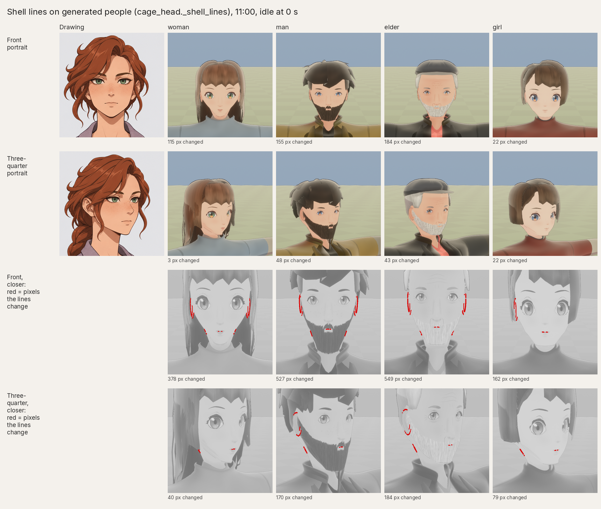

# char-port-2 · S0 · Baseline and the jaw question

S0 records where generated people stand before the back-port. Four bodies are built on main with the generator's presets: woman (seed 8, `adult-f-b`), man (3), elder (5) and girl (22, `child-u-a`). It answers the general coordinator's jaw question. [Plan](../PLAN.md) §7, S0.

[Jaw sheet](jaw-sheet.png) · [Changed pixels](lines.json) · [Face measures](face-measures.json) · [Triangles](triangles.json) · [Rerun check](rerun.json) · [Stills](stills/)

## The jaw question

> Does the generator's inside-out jaw and chin line (`_shell_lines`) cover the jaw outline for generated people at front and three-quarter?

**No.** At portrait height the generator draws three lines:
- the ears' outlines;
- the thread along the upper lip;
- a short stub at the back of the jaw, under the ear.

It draws nothing along the lower jaw or under the chin, in front or at three-quarter, on any of the four bodies. At the 58° play camera, Near and Middle, the lines change **0 pixels**.



**How it was measured.**
- **Builds:** each body twice, with the lines and with `PERSON_ARGS=--no-lines`, from the same seed.
- **Shots:** the same seven shots of each build, in the asset view as the calibration frame shoots them: 11:00, soft film, idle at 0 s, 1600 × 900.
- **What counts as changed:** any channel differing by more than 8 levels.
- **The sheet:**
  - rows 1–2 put the drawing's face beside each body's front and three-quarter portraits;
  - rows 3–4 mark in red every pixel the lines change, in the closer front and three-quarter shots.

| Pixels the lines change | Front portrait | Three-quarter | Profile | Front, closer | Three-quarter, closer | Near | Middle |
|---|---|---|---|---|---|---|---|
| woman | 115 | 3 | 3 | 378 | 40 | 0 | 0 |
| man | 155 | 48 | 79 | 527 | 170 | 0 | 0 |
| elder | 184 | 43 | 90 | 549 | 184 | 0 | 0 |
| girl | 22 | 22 | 53 | 162 | 79 | 0 | 0 |

The girl's ears are under her hair. At three-quarter, the woman's far ear is hidden and her near ear is under her hair.

Down the chin's centre column, the front close-ups with and without lines are identical, pixel for pixel. The pale band and dark edge under the chin are there in both, so they are not the shell: they are the generator's own under-jaw skin (`under`, shaded 25% toward `skin_shade`).

**Why.** `_shell_lines` builds the jaw line from the **first ring** of faces under the jaw line, pushed out along the skin's normal (1.9 mm at the chin, 1.0 mm along the jaw, none at the ear) and turned inside out (`cage_head.py:1095`). An inside-out face is drawn only where the face it copies turns away from the camera.
- **At portrait height** (pitch −10° to +8°), that first ring faces the camera: it is the visible under-chin band. So its shell is culled. Only 22–47 of the 90–115 jaw shell triangles face the camera, and they sit at the jaw angle under the ear, where the stub shows.
- **The silhouette** of the chin over the neck lies further down the under-jaw plane, where there is no shell.
- **From the 58° play camera** nearly all the shell triangles face the camera. But 1.9 mm is under a pixel at Near and Middle.

The plan's note that the shell "shows only where the jaw stands over the neck" (§8, item 1) is therefore wrong for the front and three-quarter views.

**The drawing's jaw** is one dark stroke from under the ear to the chin, about 1.7 px wide at 440 px. It is darkest at the jaw angle and thins toward the chin. On generated people that outline reads only as a change in value: skin against hair, against the collar, or against the under-jaw band.

### Two ways to get the jaw line

1. **In the generator, behind the port flag: a shell on the whole under-jaw.** Extend the shell from the first ring to every under-jaw face down to the neck ring. Its width runs from the jaw-line widths to 0 at the neck ring.
   - **What it draws:** an inverted hull is drawn exactly at the silhouette, wherever the under-jaw turns away from the camera. At portrait height that is the chin's edge over the neck, so this would be a real view-dependent line, which no carrier can be.
   - **Cost:** about 100–200 triangles per type.
   - **Limit:** it doesn't thin with distance as ink does. But at 1.9 mm it is already under a pixel at the play stops.
   - **Proposal:** I propose trying it in S1 as `port.jaw_shell` and judging it on this sheet against the drawing.
2. **In the client:** a view-dependent edge pass for characters' inner silhouettes, the follow-up recorded in char-live-3. `edges.wesl` already draws the environment's lines from what is visible.

Unless the general coordinator says otherwise, S1 will try way 1. It is cheap, it belongs to the generator, and it can be discarded on the sheet. Way 2 stays the client follow-up for the lid at three-quarter.

## Did Cora's session head carry the shell lines?

**No.**
- **char-live-2:** in all eight of its GLBs, Cora's `FaceEyeline` primitive holds 456 vertices: the eye lines and the mouth thread's pieces, at y 1.449–1.467 m. None lies in the jaw or ear region.
- **char-live-3:** the final GLB's `FaceEyeline` has 178 vertices, with |x| at most 57 mm, so there are no ear shells either.

The generator revision her session pinned (`6cab88bcd`, `docs/char-live-1/restart/replay.py:1031`) already had `_shell_lines` (added in `2c79242a6`, 12 November). The replay's `studio_preview` comment still mentions "inverted jaw/ear shells", so they were lost in a later rebuild step of that session. The exact step was not traced.

So Cora's dropped jaw carrier was never in competition with a shell line. Nor was her jaw tested with one.

## Face measures

[face_measure.py](face_measure.py) measures the type mesh at rest, from the front.
- **Widths:** taken on front-facing skin only, at the drawing's stations: cheek 0.208, jaw 0.662 and chin 0.874 of the way from the pupils down to the chin.
- **Ratios:** divided by the pupil-to-chin span, as the drawing's are.
- **Iris / eye:** the iris's width over the eye opening's (the skin's boundary loop round that eye).

| | Pupil to chin | Cheek | Jaw | Chin | Chin / jaw | Iris / eye |
|---|---|---|---|---|---|---|
| **Drawing** | – | 1.232 | 0.952 | 0.483 | **0.507** | 0.50 |
| woman (`adult-f-b`) | 101.5 mm | 1.973 | 1.040 | 0.616 | 0.592 | 0.569 |
| man (`adult-m-b`) | 132.9 mm | 1.449 | 0.872 | 0.605 | 0.694 | 0.629 |
| elder (`elder-m-b`) | 118.7 mm | 1.630 | 1.016 | 0.697 | 0.686 | 0.559 |
| girl (`child-u-a`) | 91.8 mm | 2.262 | 1.365 | 0.935 | 0.685 | 0.613 |
| Cora (char-live-3) | 89.0 mm | 1.535 | 1.031 | 0.552 | 0.535 | 0.496 |

- **Cheek is not comparable.** The mesh's front-facing skin at cheek height runs on under the hair, so the measured cheeks are far wider than the drawing's visible cheek. Use jaw and chin, which sit below the hair.
- **Chin against jaw:**
  - every generated body's chin is wide for its jaw: 0.59–0.69 against the drawing's 0.507;
  - Cora's fitted head is close, at 0.535;
  - the woman's chin is 21% wider than drawn and her jaw 9% wider.

  This is what S1's `chin_taper` and `jaw_taper` are for; the plan's women's mean, −0.22 on the chin, points the right way.
- **Iris / eye:**
  - generated irises are already wider than the drawing's 0.50 (0.56–0.63);
  - Cora's widened iris measures 0.50.

  So `eye.iris_wide` (plan §2.4) is **not needed** to reach the drawing. S1 will leave the constant, and record this.

## Triangles

`LOD=near`, `CLIPS=none`. Shells are the triangles `--no-lines` removes.

| | With lines | Without | Shells | `FaceEyeline` primitive |
|---|---|---|---|---|
| woman | 29,748 | 29,404 | 344 | 864 |
| man | 30,862 | 30,518 | 344 | 750 |
| elder | 27,722 | 27,378 | 344 | 750 |
| girl | 26,104 | 25,760 | 344 | 816 |

The plan's §6 figures (woman 30,264, man 33,304, elder 31,382, girl 27,582) were taken before main's later hair and outfit changes. These replace them as the baseline.

The composed type files (`lookdev/types/*.glb`, 13.7k–14.0k triangles each) carry the same `FaceEyeline` primitives as these bodies. So composed residents draw these same shells: 750 triangles on men's types, 810–864 on women's and children's.

## Reproducibility

The four bodies were built again under new names (`cp2r-*`) from the same seeds. [rerun.json](rerun.json)
- **Files:** every GLB binary chunk is byte-identical, and the JSON chunk is identical except for the name. The atlas, face, iris and tint pictures and the parameter files are identical.
- **Frames:** the seven shots of each rebuilt body match the first build's pixel for pixel: 0 differing pixels in all 28.

## Not measured here, and why

- **The 8-person and 64-crowd frame times** are the laptop's. The general coordinator moved the cost measurement there: windowed, on the laptop. The method, for the laptop's S3 and S7 runs:
  - **Baseline:** main's client before S3, `LIVING_GAME_FPS_CAP=0`, windowed at 1600 × 900.
  - **8 composed near people:**
    - spawned with `LIVING_GAME_CROWD=8:<seed>`, each a different type's recipe;
    - seen from the Near stop;
    - with `LIVING_GAME_PERF=frames,diag`;
    - three alternating pairs of 10 s steady windows, against the same 8 with `slop` stripped.
  - **The 64 crowd:** [`crowd.py`](../../../living/tools/characters/crowd.py) on Cullet's cast, `--runs ours,ours`, in the same alternation.
  - **Readings:** median frame time, batches, texture bytes and mesh-material pairs.
  - **Limits (approved):** +0.3 ms at 8 near and +1.0 ms on the 64 crowd.
- **The 20-check calibration frame for the woman** is registered to Cora's drawing and outfit: coat, jersey and apron patches. It doesn't apply to a generated woman in other clothes. S2 measures the skin and neck patches on her face and neck, which do apply.
- **`lidweight`, `noseweight` and hair volume on the four bodies** need per-image landmarks (canthi, pupils, nose tip) that exist only for Cora's drawing and renders.
  - **S4** gets the lid landmarks from the cage, projected into the shot, and measures the old lines and the ink arm side by side.
  - **The nose:** the same, in S2.
  - **Hair volume:** in S6.

## Reproducing

```bash
BLENDER="$HOME/.local/share/slop-tools/build-bin/blender" CLIPS=none LOD=near \
  living/tools/blender/gen_person.sh cp2-woman=woman cp2-man=man cp2-elder=elder cp2-girl=girl
BLENDER=… CLIPS=none LOD=near PERSON_ARGS=--no-lines \
  living/tools/blender/gen_person.sh cp2-woman-nl=woman cp2-man-nl=man cp2-elder-nl=elder cp2-girl-nl=girl
python3 docs/char-port-2/s0/shots.py OUT --binary <release living-game> cp2-woman … cp2-girl-nl
python3 docs/char-port-2/s0/jaw_sheet.py OUT docs/char-port-2/s0
python3 docs/char-port-2/s0/face_measure.py living/game/assets/lookdev/own-cp2-{woman,man,elder,girl}.glb \
  docs/char-live-3/ink-batch-2/own-cora-live.glb > docs/char-port-2/s0/face-measures.json
```

**The client:** a release `living-game` built from this branch's base (`b0bfa1780`, main at `735f01779` plus the plan) with the pinned rustc 1.99.1.

## Usage

S0 ran on 20 November, on Claude Opus 5.5 at high effort:
- three Blender batches of four bodies each: with lines, without, and the rerun;
- one release client build;
- three still sets.

The Blender runs waited on the coordinator's gate lock at times. Free disk stayed at 66 GB or more. There were no paid calls, no database, and no `living-check`; that is left to the merge gate.
