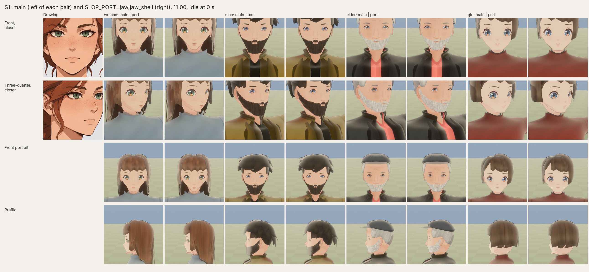

# char-port-2 · S1 · Face geometry: the jaw

S1 ports Cora's lower face into the generator, behind a flag: `SLOP_PORT=jaw,jaw_shell`. With `SLOP_PORT` unset, every type and file builds byte for byte as on main. [Plan](../PLAN.md) §2.1–2.4, §7. [S0 baseline](../s0/README.md).

[Sheet](sheet.png) · [Face measures](face-measures.json) · [Taper fit](taper-fit.json) · [Type checks](types.json) · [Play stops](play.json)



## What the flag does

**`SLOP_PORT`** is a comma-separated list of the features to switch on. It is read in two places:
- **`face_types.load()`**: it merges each named feature's per-class values from [`living/tools/characters/port.json`](../../../living/tools/characters/port.json) into the type records;
- **`cage_head`**: for `jaw_shell`.

A class is a type id without its line letter (`adult-f`), the same naming as the laptop's class ink maps. `face_types.py measure` and `build` read `types.json` raw, so they never write port values back.

### `jaw`: per-class jaw and chin tapers

These are `cage_head`'s existing `jaw_taper` and `chin_taper`, which were zero on every type. Each is a fractional offset of the local half-width. The chin's applies below 0.095 H; the jaw's from 0.15 to 0.27 H.

| Class | `jaw_taper` | `chin_taper` |
|---|---|---|
| adult-f | −0.05 | −0.18 |
| youth-f | −0.04 | −0.145 |
| elder-f | −0.02 | −0.16 |
| adult-m | 0 | −0.06 |
| youth-m, elder-m | 0 | −0.05 |
| child-u | 0 | −0.10 |

**Per-person spread** stays with the identity bones `J_Id_Jaw` (`jaw_width`, ×0.88–1.14) and `J_Id_Chin` (`chin_width`, ×0.7–1.4). Composed residents vary only through bones, so a per-person taper draw in `person_params.draw` (plan §2.1) could not reach them. **None is added.**

**Cora's carry weights** (0.395 and 0.675) belong to her session's own row override (`fit_cora_rows`, [cage-taper](../../cage-taper/README.md)), not to the generator. **Nothing to port.**

### `jaw_shell`: the inside-out jaw line over the whole underside

S0 found that the generator's jaw line draws nothing in front or at three-quarter. It is built on the first ring under the jaw, which faces the camera at portrait height, so its inside-out copy is culled.

`cage_head.CageFace._underside_shell` builds the shell over every face from the jaw line down to the neck's ring, so the inside-out copy shows wherever the jaw's silhouette falls.
- **Width:** each vertex takes the width of its nearest jaw-line vertex, thinning to nothing at the neck's ring.
- **Per expression:** like the other shell lines, it is built for each expression, so it follows talk and smile.
- **Unchanged:** the ears' outlines and the mouth thread.

**Widths.** The front close-up is measured down the midline under the chin.
- **Span:** pupils at row 325, chin at 487, so the pupil-to-chin span is 162 px.
- **Line width:** each pixel's darkness counts as a share of the line's full darkness.
- **The drawing:** its jaw stroke is 1.7 px of a 207 px span, 0.0082 of the span. It is nearly even from the ear to the chin.

| Underside shell widths (chin / jaw) | Woman: line (px), share of span | Times the drawing | Girl |
|---|---|---|---|
| Main's widths, 1.9 / 1.0 mm | 3.5 px, 0.0216 | 2.6 | – |
| First try, 1.3 / 1.1 mm | 2.4 px, 0.0148 | 1.8 | 1.85 |
| **Kept, 0.8 / 0.7 mm** (`LINE_CHIN_UNDER`, `LINE_JAW_UNDER`) | **1.2 px, 0.0076** | **0.93** | **0.96** |

*Correction:* this README first gave the 1.3 / 1.1 mm widths at 1.15 times the drawing. That figure used a wrong pupil row (a 256 px span). The table above is measured with the pupils found in the still.

## Results on the four bodies

Same presets as S0 (woman `adult-f-b`, man `adult-m-b`, elder `elder-m-b`, girl `child-u-a`), `LOD=near`, `CLIPS=none`.

**The jaw line.**
- **Front:** a line now runs under the chin and up the jaw on every body.
- **Three-quarter:** it follows the jaw from the chin toward the ear. On the man and the elder the beard covers most of it.
- **Play stops:** at Near and Middle it changes at most 29 pixels (the woman at Near), all along the chin. That is a single pixel in places, with no blots. [play.json](play.json)

**Widths.** Measured with [face_measure.py](../s0/face_measure.py), as in S0.

| | Jaw (main → port) | Chin | Chin / jaw | Drawing |
|---|---|---|---|---|
| woman | 1.040 → 1.022 | 0.616 → 0.578 | 0.592 → **0.566** | 0.952, 0.483, 0.507 |
| man | 0.872 → 0.860 | 0.605 → 0.574 | 0.694 → 0.667 | |
| elder | 1.016 → 1.012 | 0.697 → 0.698 | 0.686 → 0.690 | |
| girl | 1.365 → 1.351 | 0.935 → 0.881 | 0.685 → 0.652 | |

The elder's chin station falls in his beard's offset skin, so his chin barely moves.

**Triangles.** Each body gains 788 triangles: about 420 for the two taper rings and the rest for the underside shell.

| | Main | Port |
|---|---|---|
| woman | 29,748 | 30,536 |
| man | 30,862 | 31,650 |
| elder | 27,722 | 28,542 |
| girl | 26,104 | 26,888 |

**Expressions.** All 15 keys are there, with the same keys empty as on main (four that move other primitives). On the woman, the mouth keys now move 146–173 line vertices where main moved 66–91: the underside shell rides the jaw in talk and smile.

## How far the tapers can go

The drawing's lower face is a V: chin over jaw 0.507. [taper_fit.py](taper_fit.py) builds a type's cage skin without Blender and measures it as `face_measure` measures a GLB. Its untapered widths match the type files' within 0.008. Searching `jaw_taper` −0.20…+0.05 against `chin_taper` −0.35…0, for the drawing's chin over jaw and jaw width: [taper-fit.json](taper-fit.json)

| Line | Untapered chin / jaw | Best pair | Chin / jaw there |
|---|---|---|---|
| adult-f-a (round) | 0.650 | −0.20, −0.35 (range limit) | 0.582 |
| adult-f-b (even) | 0.594 | −0.20, −0.35 (range limit) | 0.545 |
| adult-f-c (long) | 0.545 | −0.10, −0.35 | **0.507** |

**Only line c reaches the drawing.** On lines a and b the jaw's side columns (cage columns 8–10) rise above 0.15 H, out of the chin taper's reach. The chin pad narrows; the jaw's slope above it hardly moves. Pushing both to the range limit pinches the chin onto a wide jaw: a U with a point, not a V.

So the class means above are **moderate**. They shift every woman toward the drawing and keep the round, even and long lines apart: a 0.58, b 0.566, c about 0.52. Bringing lines a and b to the drawing's V would need the jaw line itself moved (`jaw.angle_z`, `planes.jaw_line` on the type records), which changes the types' designed proportions. **That is the general coordinator's call, not S1's.**

## Plan items left out, and why

- **`eye.iris_wide`:** S0 measured every generated iris already wider than the drawing's (0.56–0.63 of the opening against 0.50). It isn't needed.
- **`eye.outer_lift_mm` and the wing:** the wing is drawn by ink now (plan §2.6), so these set strokes. They move to S4 with the carriers.
- **Neck curve** (`neck_forward_mm`, `neck_return_mm`): on all four bodies the neck is behind the hair or the collar in profile and three-quarter, so the curve wouldn't be seen. It is revisited with the hair masters (S6), where the plait leaves the neck bare.
- **Chin-pad relax:** Cora needed it for a corner her +0.24 jaw taper left. With these tapers no corner shows on any body (sheet, front and three-quarter), so no step is added.
- **Under-jaw seam:** no seam shows between the face skin and the skin under the jaw in any still. The underside shell's line now sits on that edge.
- **`sections.p00_offsets`:** not needed for the jaw. Depth stations are judged with the face paint in S2.

## Checks

| Check | Result |
|---|---|
| Flag off: the four bodies rebuilt on this branch | **Byte-identical** to main's: every GLB binary chunk, JSON but for the name, and the atlas, face, iris and tint pictures. |
| `face_types.py check`, flag off and on | 21 types ok, 200 of 200 people each, 60,648 of 60,648 value ends. The tapers aren't part of its landmark checks. |
| `cage_accept.py`, flag off (main) | **Fails 20 of 21 types**, all at the chin (0.04 H, width within 0.30 H): the cage builds the chin's sides wider than the type records, by 0.03–0.07 H. This is main's state. |
| `cage_accept.py`, flag on | 3 of 21 pass (adult-m-c, elder-m-c, youth-m-c). The 0.04 H excess falls on every type (e.g. adult-f-b 0.044 → 0.025 H). On women's types the front width at 0.04–0.12 H now runs under the record by up to 0.053 H. This is the taper's purpose: the records are the VRoid reference's proportions, not the drawing's. |
| Types with the flag (`gen_types.sh`, 21) | Built; `brow_check` and `eye_colours` pass. See below. |

Plan §7 named `cage_accept.py` as S1's acceptance, but it fails on main. It is a measure here, not a gate. If the tapered lower face is accepted, the type records' 0.04 H and 0.12 H widths should follow it.

### The 21 types with the flag

Built with `SLOP_PORT=jaw,jaw_shell JOBS=1 OUT=… gen_types.sh`, into a folder of their own. [types.json](types.json)

- **Triangles:** +768 to +796 a type (13.5k–14.0k on main, 14.3k–14.8k with the port).
- **Brows:** `brow_check` passes on all 21 types. Every brow is there and at least 0.3 mm before the skin, at rest and over 85 identity poses each.
- **Eye colours:** `eye_colours --check` passes.
- **Shared pages:** `share.py types` put all 21 on the shared pages.

| Chin / jaw | a (round) | b (even) | c (long) |
|---|---|---|---|
| adult-f | 0.650 → 0.604 | 0.592 → 0.566 | 0.544 → 0.525 |
| youth-f | 0.653 → 0.616 | 0.593 → 0.570 | 0.556 → 0.530 |
| elder-f | 0.666 → 0.617 | 0.604 → 0.567 | 0.542 → 0.523 |
| adult-m | 0.731 → 0.694 | 0.692 → 0.675 | 0.641 → 0.626 |
| youth-m | 0.729 → 0.699 | 0.669 → 0.678 | 0.643 → 0.632 |
| elder-m | 0.740 → 0.708 | 0.678 → 0.693 | 0.655 → 0.642 |
| child-u | 0.685 → 0.652 | 0.630 → 0.601 | 0.582 → 0.567 |

- **Every women's line moves toward the drawing's 0.507,** and line order is kept.
- **On the men's b line** (youth-m-b, elder-m-b) chin over jaw rises by 0.01–0.015. The chin's front narrows, but the station's widest point is on the jaw's slope, where the inserted taper rows lie a little wider. The 5–6% men's chin taper is too small to outweigh that.

## Reproducing

```bash
# The four bodies with the port (and without, for the comparison: S0's cp2-*).
SLOP_PORT=jaw,jaw_shell BLENDER="$HOME/.local/share/slop-tools/build-bin/blender" CLIPS=none LOD=near \
  living/tools/blender/gen_person.sh cp2p-woman=woman cp2p-man=man cp2p-elder=elder cp2p-girl=girl
python3 docs/char-port-2/s0/shots.py OUT --binary <release living-game> cp2p-woman cp2p-man cp2p-elder cp2p-girl
python3 docs/char-port-2/s1/sheet.py OUT docs/char-port-2/s1
# The 21 types with the port, into a folder of their own.
SLOP_PORT=jaw,jaw_shell JOBS=1 OUT=<dir>/lookdev/types living/tools/blender/gen_types.sh
python3 docs/char-port-2/s1/taper_fit.py --grid adult-f-b adult-f-a adult-f-c
```

The client is the same one S0 used (built from `b0bfa1780`); S1 changes no client code.

## Usage

S1 ran on 20 November, on Claude Opus 5.5 at high effort:
- **Blender:** three four-body batches (port at main's widths, port at the even widths, flag off) and the 21 types.
- **Bevy:** two still sets.
- **Other:** two `cage_accept` runs and one taper grid, in plain Python.

Free disk stayed at 62 GB or more. There were no paid calls, no database, and no `living-check`.
