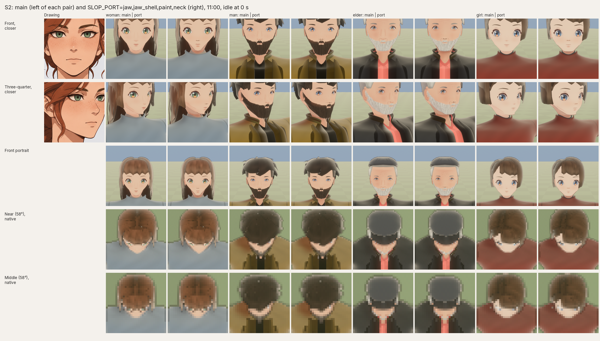

# char-port-2 · S2 · Face paint and neck

S2 ports Cora's face paint and her neck shade into the generator, behind two flags: `SLOP_PORT=paint,neck`. They sit on S1's `jaw,jaw_shell`; the sheet and measures here are with all four on. With `SLOP_PORT` unset, every file builds byte for byte as on main. [Plan](../PLAN.md) §2.5, §7. [S1](../s1/README.md)

[Sheet](sheet.png) · [Skin patches](patches.json) · [Nostrils](nostrils.json) · [Types](types.json) · [Play stops](play.json)



## What the flags do

The values live beside the code that paints them: `face_paint.PAINT` and `cage_head.NECK_SHADE`. [`port.json`](../../../living/tools/characters/port.json) names both features.

**Why head space.** The generator paints the skin in head space: each texel knows the front-view point it shows. Cora's values were atlas coordinates on her own fitted head, so they are re-expressed on the generator's own landmarks: the eyes' height, the nose's tip, base and width (`nose_wid`), the mouth's line and the chin. They follow every type and identity.

### `paint`

| Piece | Main | With the port |
|---|---|---|
| Blush | Pink spots, `BLUSH_PIGMENT` (0.70, 0.26, 0.22), 21 × 14 mm | Cora's warm pigment (0.83, 0.53, 0.40), broader (30 × 18 mm), with a band across the nose's bridge at 0.55; weight 1.5 × `look.blush` |
| Mouth | Crease 20% toward the line colour; full lower-lip tint; shade under the lip 0.42 | Crease 60% toward the line colour and 1.2 × wider; lower lip at 0.45 (diffuse); the shade under the lip at 0.60, half toward Cora's (0.60, 0.32, 0.23) |
| Nose | A shade under the tip, the wings' strokes, flank shades up the bridge, a soft light on the tip | **One shade band** hugging the underside, arching up at the sides (pigment (0.40, 0.44, 0.46)); a **glint** at the tip (1.5 × 0.9 mm, (255, 236, 211)); **two filled nostrils**: ellipses 5 × 2.6 mm leaning 14° up outward, 0.3 mm soft edge, a multiply of (0.08, 0.05, 0.05) |

**The blush stays on the types' tint page.** The lip and blush layer is a mesh of the skin faces under the paint, two rings out (`person.py`). Its UVs must stay in the window the shared tint page keeps (`share.py`: u 0.1875–0.8125, v 0.594–0.875). The broader blush first broke that on `child-u-a`, then on `elder-m-c`. So the port's blush fades out inside the window: 0.02 at the sides, 0.05 above, 0.035 below. A plain-Python copy of the layer's face selection checked all 21 types before the build.

**Nostrils on generated faces.** The look's `nostril` (0.35 on the woman, 0.07 on the girl) shades them only a little (0.75–1.0). The drawing's woman has them plain, and the look's value made women's and children's nostrils nearly vanish.

**The nose's one-sided flank shade** in Cora's drawing comes from its light, which is from the left. A painted flank would not follow the game's light, and the generator's designed face shadows (`face_shadow.py`) already throw the nose's wedge on the far cheek. So the band is symmetric and the flank is left to the shadow map.

### `neck`

Cora's neck shade (char-live-3 `ink-batch/fit.py` `neck_shade`), in linear light: the skin × (1 − depth × (0.601, 0.724, 0.728)).
- **Under the jaw:** the skin there takes it whole.
- **Down the neck:** full to 8 mm below the chin, clear by 45 mm. The edge rises 25 mm toward the sides (over 50 mm across) and fades by 0.30 round the back.

Main's neck darkened downward, toward the collar. The drawing's shade, and Cora's, is darkest right under the jaw.

## Results

**Skin patches.** [patches.py](patches.py) measures them in the front close-up. The places are the same on the drawing and on each still, in units of the pupils' spacing and the pupil-to-chin span:
- **base:** between the eyes;
- **cheek:** under the pupil, 0.30 of the span down;
- **shade:** under the chin, 0.07 of the span.

A body's skin differs from Cora's, so each drawing patch is a target relative to the body's own base: base × (drawing patch / drawing base), per channel in linear light. The plan's tolerance is ±10. The man and the elder are left out: their beards cover the cheek and chin patches.

| Delta from the drawing-relative target | Woman, main | **Woman, port** | Girl, main | **Girl, port** |
|---|---|---|---|---|
| Cheek | +3, +7, +9 | **+4, +8, +8** | +2, +8, +9 | **+3, +7, +6** |
| Shade under the jaw | +38, +37, +35 | **+7, −5, −3** | +40, +42, +42 | **+10, −3, −2** |

- **The shade under the jaw now meets the drawing** on both bodies. On main it was 35–42 levels too light.
- **The cheek was already within ±10 on main** and stays there. The port's broad blush is a change of shape, a warm field across the cheeks and nose, more than of value at this patch.

**Nostrils.** [nostrils.py](nostrils.py) measures as char-live-3's `noseweight.py` did: the still scaled to the drawing's 207 px span, and each nostril the connected region darker than halfway from the skin to the renderer's black-ink floor.

| | Drawing | Woman, main | **Woman, port** | Girl, port |
|---|---|---|---|---|
| Area (px, left / right) | 16 / 15 | none | **20 / 20** | none (lighter than half) |
| Box | 8 × 5 | – | **8 × 4** | – |
| From the midline (px) | 8.3 / 7.3 | – | **11.7 / 6.4** (mean 9.0) | – |

- **Size and depth:** the woman's nostrils now match the drawing in size and darkness (core 0.57–0.58).
- **Place:** the two sides differ by 5 px about the pupils' midpoint, which is probably the head's slight turn in the idle pose. Their mean is 15% wider than the drawing's.
- **The girl:** her nostrils show (see the sheet) but stay lighter than the threshold. A child's nose is smaller.

The plan's other nose measure, `noseweight`, needs Cora's hand landmarks; this measure replaces it on generated faces (S0's README).

**Play stops.** At Near and Middle the port changes at most 29 pixels (the woman at Near: the jaw line, S1's) and at most 14 on the others. There are no blots. [play.json](play.json)

## Plan items left out, and why

- **`paint.skin_lift`** (Cora's red lift of the whole skin). The client recolours a composed person's skin by moving the picture's mean to the person's own colour. A lift of the whole skin would be undone for every composed resident, so it belongs to the skin colours (`colors.skin`), not the paint.
- **`face_shadow` remap** (Cora's blur and gain). Cora's head bypassed the designed shadow map: her session ran `face_normals.py --flat 0` and remapped that ellipsoid map. Generated types use `face_shadow.py`'s designed maps, which already include the jaw band and the nose's wedge. Her remap has no counterpart to port. Whether the designed map's edges should be softer is a separate question for the GC's sheet.
- **Freckles** stay a person's look value (`look.freckles`). The drawing's are Cora's own.

## Checks

| Check | Result |
|---|---|
| Flag off: the four bodies rebuilt on this branch | **Byte-identical** to main: every GLB binary chunk, the JSON but for the name, and the atlas, face, iris and tint pictures. The rebuild ran before the blush's window was added; that change is inside the `paint` branch only. |
| Types with all four features (21, `gen_types.sh`) | Built. `share.py types` put all 21 on the shared pages; `eye_colours` and `brow_check` pass on all 21 and their 85 poses. 14,512–15,018 triangles: 172–288 over S1, all in the lip and blush layer, whose faces follow the broader blush. [types.json](types.json) |
| Expressions | The paint is in the atlas and the neck shade in vertex colours, so the keys are S1's. |

## Reproducing

```bash
SLOP_PORT=jaw,jaw_shell,paint,neck BLENDER="$HOME/.local/share/slop-tools/build-bin/blender" CLIPS=none LOD=near \
  living/tools/blender/gen_person.sh cp2q-woman=woman cp2q-man=man cp2q-elder=elder cp2q-girl=girl
python3 docs/char-port-2/s0/shots.py OUT --binary <release living-game> cp2q-woman cp2q-man cp2q-elder cp2q-girl
python3 docs/char-port-2/s2/sheet.py OUT docs/char-port-2/s2
F=03-clip-idle@0-0_8_0.18_0.86.png
python3 docs/char-port-2/s2/patches.py OUT/cp2q-woman/own-cp2q-woman/$F:725,325,878,325,487 …
python3 docs/char-port-2/s2/nostrils.py OUT/cp2q-woman/own-cp2q-woman/$F:725,325,878,325,487 …
```

Each argument gives the pupils' rough places and the chin's row. The chin's row is read off the midline's luminance and is the last skin row above the jaw line: woman 484 on main and 487 with the port, girl 489 and 492. The port's jaw line lies a little lower.

## Usage

S2 ran on 20 November, on Claude Opus 5.5 at high effort.
- **Iterations:** six of the woman and girl, each a Blender build and a still set: the nose band, the nostrils' place, size and value, the blush weight, and the neck's colour space.
- **The final runs:** the four bodies, the flag-off rebuild and three builds of the 21 types (two stopped at the shared tint page's window).
- **The S1 correction:** S1's line weight was re-measured and corrected along the way (S1, `8488460a0`).

Free disk fell to 46 GB once, from other workers' builds; I removed about 1.2 GB of my own closed char-live-3 scratch, leaving 48 GB. There were no paid calls, no database, and no `living-check`.
