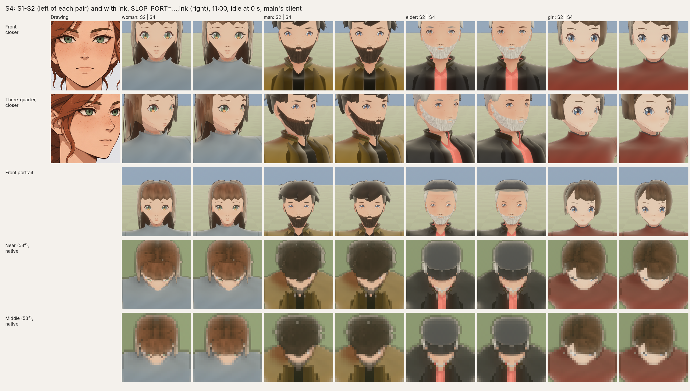
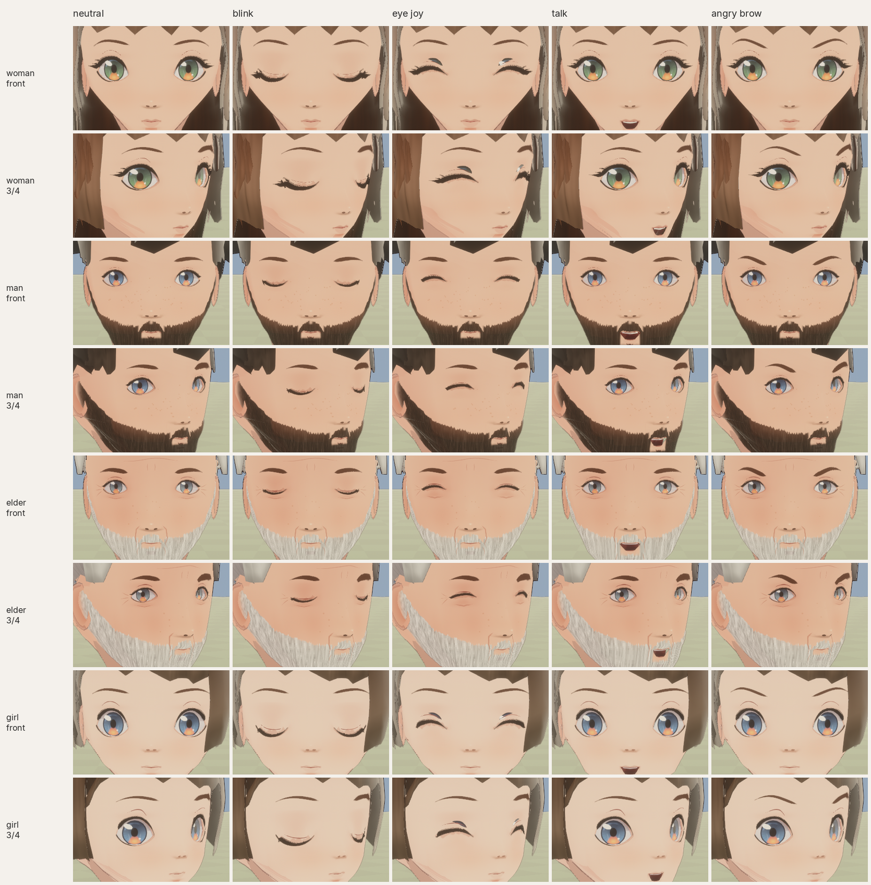
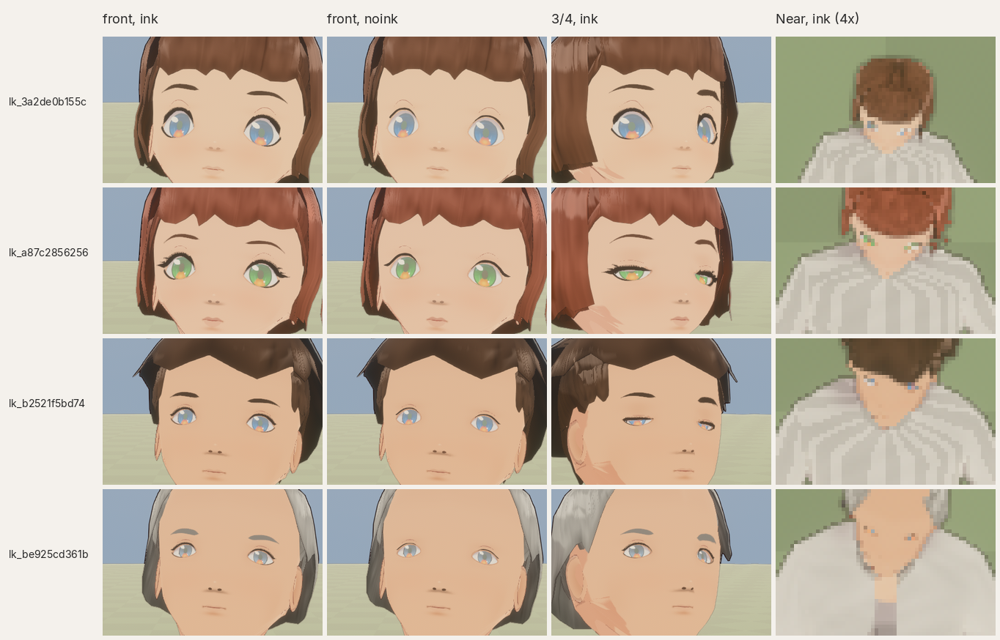

# char-port-2 · S4 · Ink carriers from the generator

The generator now draws the lid, its wing, lash flicks and fringe, the outer lower lid and the brow as ink on carriers, behind a flag: `SLOP_PORT=ink`. The carriers sit on the types' shared ink page, to the laptop's final contract ([HANDMADE_COMPOSED.md](../../HANDMADE_COMPOSED.md) v1.3, "The ink page"; [HANDMADE_INK.md](../../HANDMADE_INK.md) v1.2). With the flag off, nothing changes. The sheets and measures here are with every port feature on: `SLOP_PORT=jaw,jaw_shell,paint,neck,ink`. [Plan](../PLAN.md) §2.6, §7.

[Sheet](sheet.png) · [Morph sheet](morph-sheet.png) · [Composed people](composed-sheet.png) · [Audit](audit.txt) · [Shimmer](shimmer/) · [Lid weight](lidweight.json) · [Triangles](triangles.json) · [Page manifest](types.ink.json) · [The hair page's 1 mm prototype](hair-1mm/README.md)



## What it builds

**[`living/tools/blender/ink_carriers.py`](../../../living/tools/blender/ink_carriers.py)** builds the carriers, and `head_mesh.Face` calls it for each eye in every expression's build.
- **Morphs:** the carriers are primitives of the face mesh, so they follow the 15 keys and the identity bones by construction.
- **What ink replaces:** the old lid band, ink line, lash cards, outer fan, lower line, lower lashes and brow strip. The lid's fold stays.

**The strokes.** They are Cora's, traced from her drawing and accepted in char-live-3, kept in *eye units*: along the eye from the inner canthus (0) to the outer (1), and across it in canthus distances. Each face places them on its own eye:

| Stroke | How it is placed |
|---|---|
| Upper lid | Along the face's own opening edge (its `_lid`, so it blinks), its ink edge 0.5 mm inside the opening, with the drawn half-widths gained over the outer two thirds |
| Wing | The drawn wing beyond the outer canthus, from where the lid's centre ends; a class draws a share of its length |
| Lash flicks | The two drawn flicks, rooted on the lid's top edge |
| Fringe | A sawtooth along the lid's top edge, from 0.30 to 0.97 of the eye (Cora's: 0.9 mm spacing, 0.8 mm spikes, lean 0.35) |
| Outer lower lid | The drawn lower lid, its upper edge on the rim |
| Brow | The type's own brow stroke (`head_mesh.brow_shape`, which the brow keys move), as ink |
| Lid core | Opaque (the face's line material) inside the lid's ink, half-width hw − max(0.35 hw, 0.6 mm), so the lid keeps its weight at play distance, where the ink fades |

**What a class sets** (`ink_carriers.SEX`, `AGE`). Classes are age-sex groups, as on the page:

| | Lid width | Gain | Wing | Fringe | Flicks | Lower lid | Brow weight |
|---|---|---|---|---|---|---|---|
| Women (`-f`) | 1.0 | 1.25 | 1.0 | 1.0 | 2 | 1.3 | 1.2 |
| Men (`-m`) | 1.0 | 1.0 | 0.4 | 0.5 | 0 | 0.9 | 1.0 |
| Children (`child-u`) | 0.9 | 1.1 | 0 | 0.6 | 0 | 1.0 | 1.0 |
| Elders | × 0.85 on lid and lower lid | | | | | | |

- **Women's brow weight (1.2):** measured against the face, the drawing's brow is about 3.8 mm thick on the generated woman, against the type's 3.3 mm. Cora's accepted brows ran a little heavier than drawn.
- **Men's and children's lid widths:** set to meet the lid targets below.
- **Ink colours:** Cora's, lid (6, 2, 2) and brow (57, 32, 20). The brow carrier's name takes the hair tag, so its `ink.ref` (auburn) moves it to each person's hair colour through the palette. The elder's brow comes out grey.

### One topology a class

A carrier is a ribbon:
- **Stations:** 22 along the lid with one past each end, 9 along the lower lid, 15 along the brow.
- **Rows:** 5 across the lid and brow, 3 across the lower lid.
- **Every type of a class has the same counts.** Lines a, b and c and every person differ only in position.

**The UVs** are laid out once per class, from its line b at rest:
- **By the ribbon's own 3D lengths:** each row by its own arc length, all meeting the spine at the middle station.
- **Into the class's cell of the page:** lid, lower lid and brow islands stacked with the contract's padding (52 texels).
- **Both eyes share their islands** (they are mirror images).

For the other lines, the ribbon scales with the eye: the eye's canthus distance against line b's for the lid, and the brow's thickness for the brow.

**Measured densities on the cage skin.** Lines a and c fall on either side of line b's 1.02:
- **Lid:** 0.97–1.10 m per UV unit against the declared 1.024 (within 7.4%), with 93–99% of each lid's triangles within 25% of its median.
- **Brow:** 1.02–1.05 (within 2.6%), with 100% of its triangles within 25%.

### The page, the files and the flag

| Piece | Where |
|---|---|
| The page and its manifest | `lookdev/types/types.eyes.ink.png` (4096², G the distance, R the half-width over the range) and `types.ink.json`, with the strokes in `types.eyes.strokes.json`. Written by `type_ink.py --page` (in `gen_types.sh` with the flag), without Blender, from each class's layout. |
| A file's opt-in | `type_ink.py FILE.glb` (in `gen_types.sh` and `gen_person.sh` with the flag): the scene's `slop` `{"contract": 1}`; on each carrier BLEND, base alpha 0, no texture, and `slop` `{"slot": "eyes", "ink": …}` with `map` (the page), `m_uv` 1.024 and the page's `range` (5.5 mm, 0.005371 UV). |
| Materials | `M00_000_00_LidInk_00_FACE` (lid, flicks, fringe, lower lid; one ink object) and `M00_000_00_FaceBrowInk_00_FACE` (brows, `ref` auburn): **two materials for everyone**, as the contract asks. |
| The flag | `ink` in `living/tools/characters/port.json` |

**The range** (5.5 mm, Cora's) holds the widest half-width a class draws under the fade's bound (R ≤ 1 − 1/3). The largest R on the page is 0.53.

## Acceptance

The renders use a release client built from this branch, whose client code is main's (`a2129cd50`, S3's composed `slop`), with the pinned rustc 1.99.1. The build tree was deleted after the build (2.7 GB).

### Flag off: byte-identical

Four bodies rebuilt on this branch without `SLOP_PORT` match S0's builds of main:
- every GLB binary chunk;
- the JSON, apart from the name;
- the atlas, face, iris and tint pictures.

### The audit: 0 / 0

[audit.txt](audit.txt). `calibrate.py --no-run` gives **0 errors and 0 warnings** on:
- all 21 type files;
- the four bodies' own files;
- `--pages lookdev`, including the class check: every class's types carry the same TEXCOORD_0 on their carriers, by count and within half a texel.

Two warnings turned up along the way, and both are fixed in the carriers, not waived:
- **A brow carrier's margin behind the skin.** `brow_check` found it on four types, on the widest faces (`face_width` +1). Each row of a carrier now lies further off the face the further it is from the spine (0.12 of its offset). Every brow is now at least 0.51 mm before the skin in all 85 poses.
- **Centreline texels within range of the island's edge**, at a flick's tip and at the lid's inner end. A flick's height is now held over its neighbouring stations, and every ribbon reaches 2.5 mm further past its ends. The nearest stroke texel on the page now sits 24 texels from its island's edge, against the range's 22.

### Shimmer: passes, and fades at the play stops

`ink_shimmer.py --slot eyes --also portrait --also 0:8:0.18:0.86` on each body's own file. Pass is F_ink ≤ 1.5 × F_edge. [shimmer/](shimmer/)

| | Near / Middle / Far | Portrait, pan / zoom | Close-up, pan / zoom |
|---|---|---|---|
| woman | faded | 0.83 / 0.81 | 0.49 / 0.53 |
| man | faded | 0.80 / 0.75 | 0.43 / 0.46 |
| girl | faded | 1.00 / 1.00 | 0.52 / 0.56 |

At Near and Middle the ink changes at most 27 pixels (the woman at Near), the opaque core's. [play.json](play.json)

### Morphs: blink, eye-joy, talk, angry brow



On all four bodies, front and three-quarter:
- **blink:** the lid line, fringe and lower lid close onto the lower lid;
- **eye-joy:** they follow the lid's arc;
- **angry brow:** the brows move;
- **talk:** the eyes stay as they are.

**Not S4's: an eyeball sliver in eye-joy.** On the woman and the girl a sliver of the eyeball shows above the eye-joy arc. S2's file (no ink, the old lines) shows the same sliver: [S2 left, S4 right](eye-joy-s2-s4.png). It is the eye's geometry against the skin in that key, a follow-up for the eye, not for the ink.

### Lid weight: within ±1 px of each class's target

[lidweight_gen.py](lidweight_gen.py) measures as char-live-3's `lidweight.py` does, at the drawing's 440 px scale (the eye spanning 48 px), over the outer two thirds of the eye. The landmarks (canthi, the opening's top) are found in the still. The class targets:
- **Women:** the drawing's 7.3 px.
- **Men:** 4.0 px, the generator's own ratio of a man's lid to a woman's (about 0.55).
- **Children:** 5.1 px (0.7).
- **Elders:** 0.85 of their sex.

| Body (class target) | Band, mean (px): right / left eye | Widest | Darkness |
|---|---|---|---|
| woman (7.3) | **6.8 / 7.5** | 10.5 / 10.6 | 0.81 |
| man (4.0) | **4.3 / 4.4** | 6.0 / 6.0 | 0.64–0.65 |
| elder (3.4) | **3.4** / not measured | 5.3 | 0.57 |
| girl (5.1) | **4.6 / 4.4** | 9.0 / 7.6 | 0.63 |

- **The elder's left eye:** the measure didn't find its opening (it isolated 23 px of it), so it isn't counted.
- **Darkness** runs above the drawing's 0.59 on the woman (0.81). Her rounder eye puts more of the measuring box on the band, and the opaque core adds weight. Lid colour and darkness belong with the calibration frame for composed people, which is the laptop's (`calibrate.py --line`).

### Composed people: the type files' ink on the composed path



[composed_shots.py](composed_shots.py) draws four look lines from a small [book](book.json) (adult-f-b, adult-m-b, elder-m-b, child-u-a, with main's hair and outfit styles), with ink and with `LIVING_GAME_COMPOSED_SLOP=noink`.
- **Close-ups:** the ink darkens 1,376–2,834 pixels a shot.
- **Near and Middle:** 0 (faded).
- **The brows follow each person's hair tag** (the elder's grey).

### Triangles

[triangles.json](triangles.json)

| | S2 | S4 | Of which carriers |
|---|---|---|---|
| Type files | 14,512–15,018 | **15,004–15,450** (+378 to +492) | 448 lid, 256 brow |
| woman / man / elder / girl | 30,756 / 31,902 / 28,710 / 27,144 | **31,134 / 32,394 / 29,202 / 27,570** | 704 |

- **What the carriers replace:** the old eye lines and lash cards (the eye-line primitive goes from 1,086–1,200 triangles to 954, with the core and the jaw shell) and the 80-triangle brow strip.
- **Against the plan:** the net is under §6's estimate (+700 to +900), and every body is well under the 50,000 near ceiling.

## Choices and what is left out

- **Per-person stroke variation is class-level.** One ink object and one cell serve a whole class, as the contract asks. A person's lid and brow vary through their eye's and brow's own shape and the identity bones, not through the strokes.
- **Strokes in eye units, not the drawing's registration.** The generated eye is rounder and larger than Cora's almond eye. The lid follows each eye's own edge, so the stroke's length follows the eye. Its width keeps the drawing's share of the eye.
- **The page at 0.25 mm a texel holds** every class's islands in its 1024-texel cell (the adult-f lid is 434 × 139 texels), so no finer page is needed.
- **The old lines stay for files without the flag** (main).
- **Not here:** the calibration frame for composed people and the cost A/B are the laptop's, as is S3's proof. The bundle check (`pictures.py check`) runs on a bundle with these files: S8.

## Reproducing

```bash
P=jaw,jaw_shell,paint,neck,ink; B="$HOME/.local/share/slop-tools/build-bin/blender"
SLOP_PORT=$P JOBS=1 BLENDER=$B living/tools/blender/gen_types.sh          # the 21 types and the ink page
SLOP_PORT=$P BLENDER=$B CLIPS=none LOD=near living/tools/blender/gen_person.sh cp2i-woman=woman cp2i-man=man cp2i-elder=elder cp2i-girl=girl
for f in living/game/assets/lookdev/types/*.glb; do python3 living/tools/characters/calibrate.py lookdev/types/$(basename $f) --no-run; done
python3 living/tools/characters/calibrate.py --pages lookdev --no-run
python3 living/tools/characters/ink_shimmer.py lookdev/own-cp2i-woman.glb --slot eyes --also portrait --also 0:8:0.18:0.86 --binary BIN
python3 docs/char-live-3/ink-batch/morph_stills.py lookdev/own-cp2i-woman.glb OUT --binary BIN --keys Fcl_EYE_Close,Fcl_EYE_Joy,Fcl_MTH_A,Fcl_BRW_Angry --shot 0:8:0.18:0.86 --shot -35:8:0.18:0.86
python3 docs/char-port-2/s4/composed_shots.py docs/char-port-2/s4/book.json OUT --binary BIN
python3 docs/char-port-2/s4/lidweight_gen.py STILL.png:PX,PY …
```

## Usage

S4 ran on 20 November, on Claude Opus 5.5 at high effort, for about 5.5 hours, including Blender's waits.
- **Blender:** five builds of the 21 types (three to fix the audit's findings and the class widths), and the bodies with each.
- **Client:** one release build.
- **Acceptance:** three full runs.

Free disk stayed at 54 GB or more. There were no paid calls, no database, and no `living-check`.
