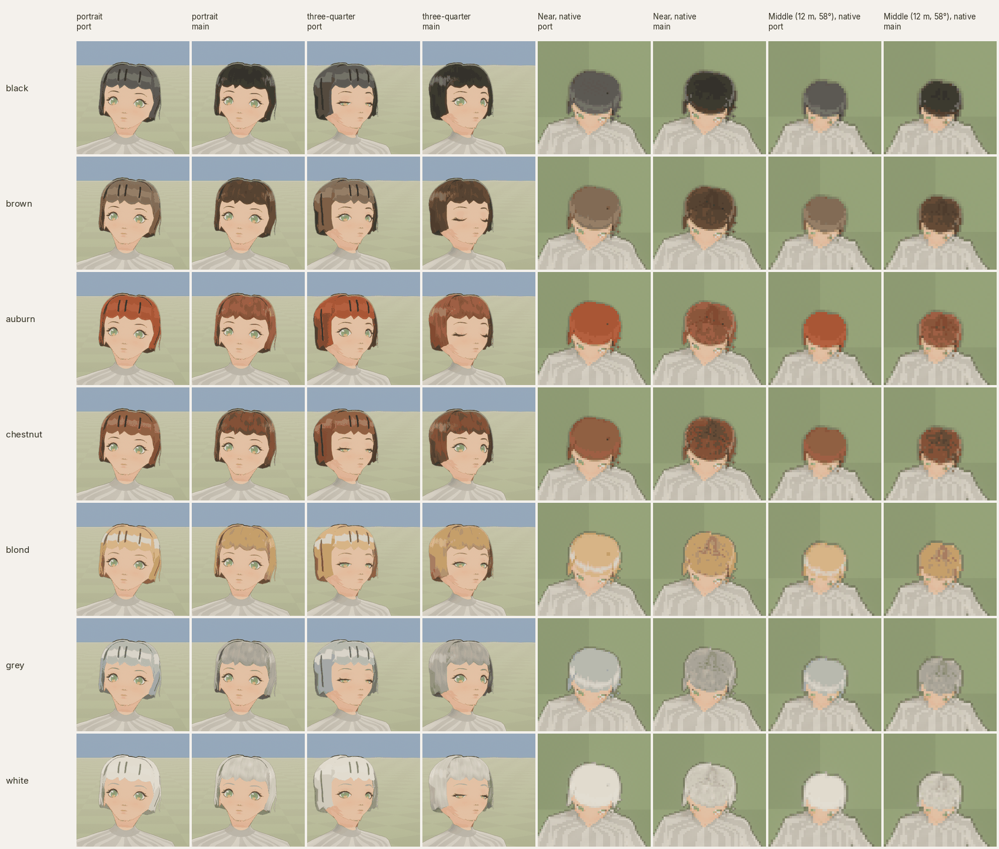

# char-port-2 · S5 · The hair profile from the generator

The generator now lays every hair style out for the handmade-hair profile on the shared hair-mask page, behind a flag: `SLOP_PORT=hair`. A composed person's hair is then drawn by the profile (bands, a highlight, lock lines), with one palette relative to the person's hair tag and an anchor per colour bin. This follows the laptop's final contract: [HANDMADE_COMPOSED.md](../../HANDMADE_COMPOSED.md) v1.3, "The hair-mask page" and "The palette", and [HANDMADE_HAIR.md](../../HANDMADE_HAIR.md) v1.1. With the flag off, nothing changes. [Plan](../PLAN.md) §3, §7.

[Rows, every colour, S5 beside main](rows.png) · [Lock-line close-ups](closeups.png) ([numbers](closeups.json)) · [Page 0](page0.png) · [bob's cells at 1:1](page-bob.png) · [Calibration](bins.json) ([re-measured on the final build](bins-check.json)) · [Shimmer](shimmer/) · [Audit](audit.txt)

## What it builds

**[`hair.page_layout`](../../../living/tools/blender/hair.py)** lays out each style's hair at 1 mm a texel. `person.make_hair` calls it with the flag on:

- **Pieces.** Each connected run of faces is its own UV island: every sheet, ribbon, bun, braid and tie. The scalp's cap is laid out flat, seen from above. Every other piece keeps its strand mapping, scaled along and across to its own lengths in metres.
- **Density.** Each piece's median triangle is made exactly 1 mm a texel, so `ink_m_uv` (4.096 m per UV unit) holds on every file within the audit's 10%.
- **Packing.** The pieces go into the smallest of 1×1, 2×1, 1×2 and 2×2 page cells (512 texels each) that holds them. The padding is 20 texels (2 × `ink_range` + 8) and the packer is a skyline packer, which may turn a piece a quarter.
- **The far mesh** (`FarHair`) has fewer, thinner locks than the near mesh. Each far piece takes the near piece most of its vertices lie nearest to, and with it that piece's scale, density, origin and place. A point the two meshes share lands on the same texel, and anything that runs past the box is held at its edge.
- **The highlight** (`hair.highlight`, exported as `_HIGHLIGHT`): a scalloped band 4–7.5 cm below the top of the hair, on the side facing out from the head. It is soft at 4 mm, and it is left off the face side beyond 140°.
- **The lock lines.** A line runs up each notch between a sheet's points: a column cut back by 55% or more. Each line starts 9 texels above the tip, clear of the island's border, and stops 55% of the way up. The near mesh writes them, in page texels, to `<style>.hairpage.json`.

**[`hair_page.py`](../../../living/tools/characters/hair_page.py)** puts the files on the page:

- **Placement.** Files go in sorted order, each into the first free cells, and their hair UVs (`Hair` and `FarHair`) move into those cells.
- **The material.** It drops its texture and `_RING`, and takes the profile. The scene opts in with `slop {"contract": 1}`.
- **The page.** R is each file's `_HIGHLIGHT`, rasterised from its near mesh. G is the lock lines' distance field over `ink_range` (6 texels).
- **The manifest.** It writes `hair-masks.json`.

`gen_styles.sh` keeps each `.hairpage.json` beside its style.

**The profile** (every file on a page carries the same one):

| | |
|---|---|
| `palette` | `"tag"`, `ref` auburn (102, 46, 26): Cora's hair, her accepted swatches as its own |
| swatches at `ref` | shade (38, 1, 0), mid (101, 34, 6), light (119, 44, 5), highlight (139, 53, 3), after calibration |
| thresholds | `t1` −0.2, `t2` 0.4, `edge` 0.02, `highlight_feather` 0.08 (Cora's) |
| lock ink | `ink` (4, 0, 0), `ink_px` 1.05, `ink_fade_px` 2.0 (Cora's), `ink_range` 6/4096, `ink_m_uv` 4.096 |
| `anchors` | dark (19, 17, 17), light (158, 125, 71), grey (133, 133, 133), each with its own four swatches |
| `highlight_map` | the file's page |

## Capacity: three pages

The page is 4096² with 8 × 8 cells, which is 64 cells. The generator's 86 style files need **190 cells**:

- most files take 2 cells;
- the long, collared and braided cuts take 4.

That fills **three pages**: 64, 64 and 62 cells (`hair-masks.png`, `-1`, `-2`). Each page is its own material (one profile per page), and the manifest lists them in `pages`. The client draws files from every page (bob is on the first and long on the second, as the rows and close-ups show), and the audit checks all three.

**For the coordinator's decision:** the alternatives are three pages, or:
- 2 mm a texel: every file in one cell, two pages;
- an 8192² page;
- fewer pieces.

Each page is 0.2–0.3 MB as PNG.

## Acceptance

### The audit: 0 / 0

[audit.txt](audit.txt). `calibrate.py --no-run` gives **0 errors and 0 warnings on all 86 files**: line texels at least `ink_range` inside their island, and the measured `ink_m_uv` within 10%. `--pages lookdev` is also **0 / 0**, over all three pages:
- every file opts in;
- one profile per page;
- every hair UV (near and far) inside the file's cells;
- no overlapping cells;
- each file's density within 10% of the page's.

[`composed_audit.pages`](../../../living/tools/characters/composed_audit.py) now reads a manifest's `pages`; a single-page manifest is read as before.

### Hair patches per colour bin: within ±8, but one band

[calibrate_bins.py](calibrate_bins.py) draws a composed woman in bob through the client, at the calibration portrait and three-quarter (11:00, soft film), once per bin. It measures the median colour of each profile band, and the bands are found from a debug copy with pure band colours.

**The targets:**
- **auburn:** the drawing's patches (Cora's calibration);
- **the other bins:** the drawing's patches moved to the bin's colour by the palette's own rule (`palette.entry`);
- **dark:** with a floor on lightness, so near-black hair draws readable greys;
- **every bin:** with a ceiling, so light hair keeps four bands.

Three rounds ([bins.json](bins.json)); re-measured on the final build ([bins-check.json](bins-check.json)):

| Bin | shade | mid | light | highlight |
|---|---|---|---|---|
| auburn | (0, **14, 16**) | (0, 0, 2) | (0, 0, 2) | (1, 0, 4) |
| dark | (2, −1, −8) | (0, −1, 0) | 0 | 0 |
| light | 0 | 0 | 0 | (1, 2, 1) |
| grey | 0 | 0 | 0 | (2, 1, 1) |

**Auburn's shade is out by 14 and 16 in green and blue, and it cannot come closer.** Its swatch is already (38, 1, 0). The sky's fill lights the shade band to about (61, 56, 45) even with a black swatch at 11:00. So the drawing's shade (88, 42, 27) is below what the grade shows in those channels. This is a floor of the lighting, not of the profile. Dark's shade blue sits at −8, on the tolerance.

### Black hair lifts to readable greys

The dark anchor draws near-black hair (#131111) as greys in order: shade, mid, light, highlight at OKLab lightness 0.35, 0.42, 0.46 and 0.55. The lock lines (ink, near black) and the highlight stay visible on them: see the black row of [rows.png](rows.png), and the black close-ups, where the line is the same width and as dark as on auburn.

### The rows: every colour at portrait, three-quarter, Near and Middle (12 m, 58°)

[rows.png](rows.png): bob on a composed woman, S5 beside main, in seven of the generator's colours: black, brown, auburn, chestnut, blond, grey and white. The light-hair row the coordinator asked for is blond, grey and white, and the reds are auburn and chestnut. [hair_rows.py](hair_rows.py) draws it.

- **Light hair keeps its bands and lines.** The highlight reads on blond and grey. On white it is too close to the hair to show, which is expected: the ceiling holds white's light and highlight at nearly the same lightness.
- **At Near and Middle the hair is flat bands.** Main's strand texture showed as speckle at those distances. The lock lines fade out at Middle, as `ink_fade_px` 2.0 means them to.
- **Found, not caused by S5:** a 1–2 px dark dot on the crown at Near, in every colour. Main draws it at the same pixel (luminance 62 against S5's 68); main's speckle hides it. It stays with the hair's ink off, so it comes from the geometry.
- **Not drawn: the parting.** Main's strand texture showed the parting. The profile draws only the bands, the highlight and lines up the notches, so the crown reads as one plain surface from above. A parting line would be one more crease source: an open point for the GC.

### Lock lines up close at the 1 mm page

[closeups.py](closeups.py). It draws bob (auburn and black) and long (auburn) with and without the hair's ink: portrait (zoom 0.36), close (0.18) and closer (0.10), each front and three-quarter. The ink is the pixels the line darkens by more than 8 levels. [closeups.png](closeups.png), [closeups.json](closeups.json).

| | lines (≥ 6 px) | width, median / p90 (px) | gaps | darkest |
|---|---|---|---|---|
| bob, auburn, 0.36 → 0.10 | 3–6 | 5–6 / 6 | 0 | 67–85 |
| bob, black, 0.36 → 0.10 | 3–5 | 5–6 / 6 | 0 | 68–82 |
| long, auburn, 0.36 → 0.10 | 12–27 | 4–6 / 8–10 | 0 | 66–109 |

- **The lines hold at the 1 mm page.** Their width stays the same in pixels while the zoom changes 3.6×, and no line breaks.
- **Long's wider p90 (8–10 px)** is likely where lines cross the hair's silhouette or lie close together at three-quarter. I haven't traced it line by line.

The client's blink runs on the clock, so a render can catch a blink the other render missed; those eye pixels are dropped from the measure.

### Shimmer at fade 2.0

`hair_shimmer.py look:<key> --also portrait` was run on bob (auburn and black) and long (auburn), with `ink_fade_px` 2.0 as the profile carries it. The results are in [shimmer/](shimmer/).

| | Near, Middle, Far | portrait pan | portrait zoom |
|---|---|---|---|
| bob, auburn | faded | **1.02** (740 px) | 0.32 (737) |
| bob, black | faded | **0.35** (713) | 0.24 (722) |
| long, auburn | faded | **0.31** (1786) | 0.28 (1830) |

Every sequence with lines passes (≤ 1.5).

**The lines are faded at all three game stops.** `ink_range` is 6 texels, which is 6 mm at the 1 mm page. The client estimates neighbouring lines' spacing as 2 × `ink_range` (12 mm), and that is under 2 px already at Near (about 8 mm a pixel). So the lines draw at portrait and close-up, and are gone in play. Cora's hair, at `ink_range` 0.05 UV (about 31 mm), kept them to Middle. This is a choice for the GC:

- **Keep 1 mm and 6 texels:** lock lines are a close-up feature only.
- **Raise `ink_range`** toward half the real narrowest spacing (bob's lines are 40–60 texels apart). The island padding grows with it (2 × range + 8), so capacity drops again.
- **A 2 mm page:** the same 6 texels give 12 mm, so lines last to Near. Every file then fits one 512 cell, so 86 cells: two pages. One page would need 256-texel cells, a contract change. The lines would be coarser at portrait; the 1 mm prototype didn't test 2 mm.

**Two fixes to the tool** ([`ink_shimmer.py`](../../../living/tools/characters/ink_shimmer.py), the module `hair_shimmer.py` calls):

1. **The blink.** The client's blink runs on the clock, so the plain render and the inked render can catch different blinks. The first bob/auburn run failed its portrait pan at 1.72: the ink signal doubled in two frames, all at the eyes. Ink only darkens, so pixels where the inked frame is lighter by more than 8 levels are now left out, dilated by 3 px. Re-scored from the same stills, that pan measures 1.02.
2. **Black hair.** Its region was found by hue and saturation above 0.2, which grey and black hair don't have, so the region was the skin. Hair whose median saturation under the ink is below 0.2 now takes the unsaturated pixels within 60 levels of its luminance there.

S4's eye-ink stills are gone, so S4's numbers weren't re-scored. The guard removes only pixels that ink can't have made, and the grey rule touches only the hair slot.

### Flag off: byte-identical

Eight styles were built with main's generator (`origin/main`'s `living/tools`, whose generator is unchanged since the S0–S2 merge) and with this branch without `SLOP_PORT`:
- bob, long.2.collar, braid.3.collar.full, balding.3, crop.cap, bun, tail.m and kerchief.

**Every GLB binary chunk is identical.** The JSON is identical apart from the strand picture's relative URI, which names where each source tree sat. No `.hairpage.json` is written without the flag.

## Not covered

- **The four-body proof and the cost budget:** these are S7's.
- **Hair masters in Cora's grammar** (§3's `swept_braid`): these are a later step. S5 carries the generator's existing styles onto the profile.
- **A parting line:** see the rows above.
