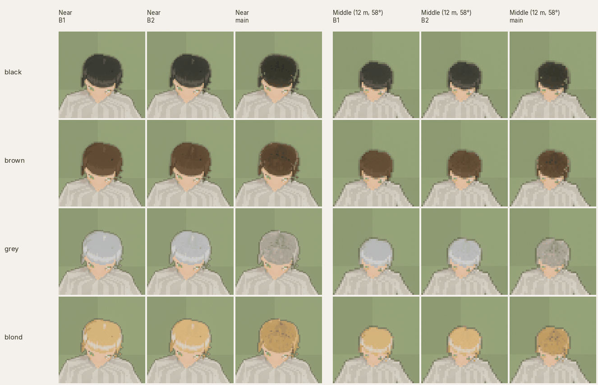

# char-port-2 · S5 · The hair profile from the generator

The generator now lays every hair style out for the handmade-hair profile on the shared hair-mask pages, behind a flag: `SLOP_PORT=hair`. A composed person's hair is then drawn by the profile: bands, a highlight, lock lines, a parting, and main's strands under the bands at low contrast. It takes one palette relative to the person's hair tag, with anchors for black, brown, blond and grey. With the flag off, nothing changes.

This follows the laptop's contract, [HANDMADE_COMPOSED.md](../../HANDMADE_COMPOSED.md) v1.3 ("The hair-mask page", "The palette") and [HANDMADE_HAIR.md](../../HANDMADE_HAIR.md) v1.1, with **two proposed amendments**, below. [Plan](../PLAN.md) §3, §7.

**Two passes.** The first (`e73de3751`) built the profile output. The GC's answer then set four things:
- three pages at 1 mm;
- lock lines close-up only;
- a parting;
- one more pass on the dark palette, the structure at play distance and the fringe's lines.

This README is the result of the second pass.

[Rows: every colour, S5 beside main](rows.png) · [B1, B2 and main at Near and Middle](compare.png) · [Middle luma](luma.json) · [Lock-line close-ups](closeups.png) ([numbers](closeups.json)) · [Page 0](page0.png) · [bob's cells at 1:1](page-bob.png) · [Calibration](bins.json) ([check on the final build](bins-check.json)) · [Shimmer](shimmer/) · [Surface flicker](flicker.json) · [Audit](audit.txt)

## The GC's decisions (2026-11-20)

1. **Capacity:** three pages at 1 mm a texel, no contract change.
2. **Lock lines:** close-up only, like Cora's face ink. Fading before Near is accepted.
3. **Parting:** added, as one more source of lines in the generator. Structure at play distance comes from the bands and the parting.

## The second pass

### (a) The dark palette: black reads black, brown sits between

**The problem:** the first pass's dark anchor raised black's four bands to OKLab lightness 0.35–0.55, so black and brown hair read as grey at Near and Middle.

**Why brown needs its own anchor.** One anchor moves a swatch's lightness by the tag's ratio to its `ref`. Brown (51, 34, 23) is 1.8 times black's lightness. So with one dark anchor, a black that is readable put brown above auburn (first pass at Middle: brown 115, auburn 105, black 94). No single dark anchor gives both, so brown takes an anchor of its own.

**The change:**
- **Anchors:** black, brown, blond and grey. The contract allowed 3, which is the first amendment below.
- **Floors:** black's and brown's floors are lowered to what play distance needs (`calibrate_bins.py` `FLOOR`):
  - black: shade 0.30 (the sky floor), mid 0.31, light 0.345, highlight 0.44;
  - brown: 0.32, 0.39, 0.43, 0.47.
- **Up close,** the lock lines (ink, near black) and the highlight carry dark hair, not a lifted palette.

**Acceptance: mean hair luma at Middle** (12 m, 58°). The hair pixels are where the white row and the black row differ by more than 40 levels; the luma is 0.2126 R + 0.7152 G + 0.0722 B of the screen's sRGB. Source: [luma.json](luma.json), from `hair_rows.py luma`.

| Middle, mean hair luma | black | brown | chestnut | auburn | blond | grey | white |
|---|---|---|---|---|---|---|---|
| **S5, second pass (B2)** | **70.6** | **84.5** | 98.7 | 104.6 | 184.4 | **185.7** | 213.2 |
| B1, the other variant | 70.8 | 84.8 | 98.7 | 104.6 | 183.2 | 184.8 | 212.7 |
| S5, first pass | 94.2 | 115.1 | 106.1 | 104.8 | 184.0 | 185.6 | 215.5 |
| main | 66.9 | 80.0 | 91.0 | 100.2 | 157.0 | 162.5 | 196.6 |

On the second pass:
- **Black is 70.6**, 3.7 levels above main's black (the margin allows 8).
- **Brown − black is 13.9** (≥ 12; main's is 13.1).
- **Grey − brown is 101** (≥ 40; main's is 82).
- **The order holds:** black < brown < chestnut < auburn. Black sits 115 below grey and brown 101 below, so black is further below grey than brown is.

The first pass failed two of these: black was 27 above main's, and brown sat above auburn.

**The margin proposed, and why:**

- **Black ≤ main's black + 8.** Black reads as black as main's does. 8 levels is the calibration's own tolerance.
- **Brown − black ≥ 12.** That is main's own separation of the two at Middle (13), and about 0.04 in OKLab lightness at these levels. It is roughly three just-noticeable steps, so black and brown hair tell apart on a 240-pixel head.
- **Grey − brown ≥ 40.** Grey must read as grey-haired, not as light brown.
- **Black below brown,** so black sits further below grey than brown does. Brown also stays below chestnut and auburn.

**Calibration** stays within its limits: every bin within ±4, with auburn's shade the exception S5 noted. That shade is held light by the sky's fill (G and B +15 and +17; the swatch is already (35, 1, 0)).
- **Rounds:** [bins.json](bins.json).
- **Check:** re-measured on the final build in [bins-check.json](bins-check.json).

| Bin (final build, round 0 of the check) | shade | mid | light | highlight |
|---|---|---|---|---|
| auburn | (1, **15, 17**) | (0, 0, 2) | (0, 0, 2) | (0, 0, 3) |
| black | (1, 1, 2) | (4, 3, 1) | (1, 1, 0) | (1, 0, 0) |
| brown (new) | (3, 4, 0) | (−1, 0, 0) | (−1, 0, 0) | 0 |
| blond | (0, 0, 1) | (1, 0, 0) | (2, 1, 0) | 0 |
| grey | (0, −1, 0) | (1, 1, 0) | (1, 1, 1) | 0 |

**Calibrated with the strands under the bands:** B2 lifted each band's median by 6–11 levels until the swatches were tuned again.

### (b) Structure at play distance: B1 and B2, side by side

Both variants carry the parting (below) and the new lock lines. [compare.png](compare.png) shows black, brown, grey and blond at Near and Middle, B1 beside B2 beside main.

- **B1, band-structure variation** (`SLOP_HAIR_LOOK=b1`, `hair.Hair._lock_round`): each lock, a point of a sheet's hem from notch to notch, is shaded as a low cylinder. Its normals turn across it toward its sides, by up to 0.6 times the lock's own amount, more toward the hem. The bands' edges then break lock by lock.
- **B2, main's strands under the bands** (the default, `hair_page.strands_bake`): main's strand picture, at each vertex's own strand mapping, times main's per-vertex shading (root, notches, hem), is baked into the page's **B** at 0.9 of its contrast. The client multiplies the three bands (not the highlight or the ink) by 2 B. This is the second amendment, and it needs a client step: three lines in `toon.wesl` `hand_hair`.

**Shimmer, both under 1.5.** `hair_shimmer.py` on bob at fade 2.0; the lines fade before Near, so the game stops are faded and not scored.

| | portrait pan, auburn / black | portrait zoom, auburn / black |
|---|---|---|
| B1 | 0.23 / 0.38 | 0.21 / 0.24 |
| B2, the side-by-side (before B2's recalibration) | 0.79 / 0.33 | 0.21 / 0.21 |
| B2, the final build | 0.26 / 0.32 | 0.22 / 0.21 |

**The surface's own flicker** ([surface_flicker.py](surface_flicker.py), [flicker.json](flicker.json)). B2's strands are a texture, and the test reads the PNG page without mips (the game reads its KTX2 copy with mips). So I measured how much the hair's surface itself flickers in the game camera's pans and zooms. The figure is F, the second temporal difference over the luminance, on bob in auburn.

| F | Near pan | Near zoom | Middle pan | Middle zoom | Far pan | Far zoom |
|---|---|---|---|---|---|---|
| B1 | 0.0029 | 0.0109 | 0.0027 | 0.0072 | 0.0024 | 0.0104 |
| B2 | 0.0033 | 0.0139 | 0.0029 | 0.0105 | 0.0030 | 0.0111 |
| main | 0.0069 | 0.0321 | 0.0064 | 0.0298 | 0.0057 | 0.0279 |

**B2 is 10–45% above B1, and both are 2–3 times steadier than main.**

**Which reads better: B2.**
- **At portrait and three-quarter:** B2's hair reads as hair, with fine streaks along the locks in every band, as main's did, and the bands and lines on top. B1's lock-wise band breaks read as facets: blocks of light and dark on the side hair.
- **At Near:** B2 keeps a little of main's grain, and B1 is smooth with its band edges broken.
- **At Middle:** both are mostly the two bands and the highlight. B2 keeps a faint grain on the light hair, and B1 a broken lower edge.

Neither is as busy as main, whose speckle is also what flickers.

**The cost of B2:**
- **The client step:** `hand_hair` reads B in the tap it already makes, with a select and a multiply.
- **The contract:** B as strands, 0 meaning none.

B1 needs neither; `SLOP_HAIR_LOOK=b1` builds it again if the GC prefers it.

### The parting

Where the hair parts:
- **Over-sheet styles** (shag, bob, bob_parted, long): `Hair.over` records the line between the two sides' roots, from the front over the top to the crown, 84°–122° from the front.
- **Curtain fringes:** from 70°, where the fringe parts too.
- **Braids:** down the middle.

`hair_page.parting_strip` draws it into R, the highlight: a pale strip 10 mm wide tapering to its ends. It goes on whatever lies within 14 mm of the scalp along the line, which is the cap between the two sides and the sides' root edges. It shows in the lit band as the scalp does in a parting. Light-independent, it is the one structure that holds at every distance, with the band edges.

- **Coverage:** 57,780 texels over the 86 files.
- **Close-up:** the parting is the pale strip; it isn't drawn as ink.

### (c) The fringe's lock lines

**The first pass:** one line straight up each notch, all to 55% of the way. They read at portrait as two or three stiff vertical slits.

**Now** (`hair.Hair._lock_lines`, `LOCK_LINES`), grouped into locks, as the plait's "melon stripes" lesson asks:
- **Notch lines:** up each notch, a line 30–72% of the way to the root. It bends across by up to 1.3 columns (t²·², so it curves as the lock turns), and its length and bend are its own.
- **Companions:** beside half the notches, inside the lock, a shorter one (16–40%) starts 30–55% of the way to the point's tip and bends with its notch.
- **Edges:** never on a sheet's own edge columns, so a line keeps `ink_range` from its island's border.
- **Random numbers:** the lines have their own, so the hair's shape doesn't change.

The lines are bilinear on the sheet's grid, in page texels. There are 1,772 over the 86 files; the first pass had 868.

## What it builds

**[`hair.page_layout`](../../../living/tools/blender/hair.py)** lays out each style's hair at 1 mm a texel; `person.make_hair` calls it with the flag on.
- **Pieces:** each connected run of faces is its own UV island. The scalp's cap is laid out flat, from above; every other piece keeps its strand mapping, scaled to its own lengths.
- **Density:** each piece's median triangle is exactly 1 mm a texel.
- **Packing:** the smallest of 1×1, 2×1, 1×2 and 2×2 cells of 512 texels, with padding of 2 × `ink_range` + 8, skyline-packed and turned where needed.
- **The far mesh:** each `FarHair` piece takes the place of the near piece its vertices lie nearest to.

`person.make_hair` writes `<style>.hairpage.json`, holding the rectangle, the lock lines in texels and the parting, and the near mesh's `_HIGHLIGHT`. With B2 it also writes `_STRANDU`, `_STRANDV` and `_STRANDK`, which `hair_page.py` reads and removes.

**[`hair_page.py`](../../../living/tools/characters/hair_page.py)** puts the files on the pages, 190 cells on three pages.
- **The material:** it drops the texture and `_RING`, and takes the profile. The scene opts in.
- **The page:** R the highlight and the parting; G the lock lines' distance field over 6 texels; B the strands.
- **The manifest:** it writes `hair-masks.json`, which lists `pages`.

**The profile** (the same on every file of a page):

| | |
|---|---|
| `palette` | `"tag"`, `ref` auburn (102, 46, 26), Cora's hair |
| swatches at `ref` | shade (35, 1, 0), mid (92, 30, 5), light (108, 39, 4), highlight (138, 53, 3): calibrated with the strands under them |
| thresholds | `t1` −0.2, `t2` 0.4, `edge` 0.02, `highlight_feather` 0.08 (Cora's) |
| lock ink | `ink` (4, 0, 0), `ink_px` 1.05, `ink_fade_px` 2.0 (Cora's), `ink_range` 6/4096, `ink_m_uv` 4.096 |
| `anchors` | black (19, 17, 17), brown (51, 34, 23), blond (158, 125, 71), grey (133, 133, 133) |
| `highlight_map` | the file's page |

## Two proposed amendments, for the laptop

1. **Up to 4 anchors** (was 3): HANDMADE_COMPOSED's table and audit, `handmade.rs` (one constant) and `composed_audit.py`. The reason is under (a).
2. **The page's B as strands** (was 0): HANDMADE_COMPOSED "The hair-mask page" and `toon.wesl` `hand_hair`. The client multiplies the bands by 2 B; B 0 is none, so a page without strands, or any older file, draws exactly as before.

The release client these renders use (`living-game-b2`) is main's client with both steps. Its build tree was deleted after the build.

## Acceptance

### The audit: 0 / 0

[audit.txt](audit.txt). `calibrate.py --no-run` gives **0 errors and 0 warnings on all 86 files.** `--pages lookdev` is **0 / 0** over all three pages:
- every file opts in;
- one profile per page;
- every hair UV inside the file's cells;
- no overlap;
- density within 10%.

The audit now reads a manifest's `pages`, and allows 4 anchors.

### The rows

[rows.png](rows.png): bob on a composed woman, in black, brown, auburn, chestnut, blond, grey and white, at portrait, three-quarter, Near and Middle (12 m, 58°), S5 beside main. [hair_rows.py](hair_rows.py) draws it.

- **A 1–2 px dark dot on the crown at Near** is in main's geometry too: main draws it at the same pixel, and main's speckle hides it. S5 didn't cause it.
- **On white hair** the highlight is too close to the light band to show, since the ceiling holds both near the top.

### Lock lines up close at the 1 mm page

[closeups.py](closeups.py): bob in auburn and black, and long in auburn, with and without the hair's ink. Zooms 0.36, 0.18 and 0.10, each front and three-quarter. [closeups.png](closeups.png), [closeups.json](closeups.json).

| | lines (≥ 6 px) | width, median / p90 (px) | gaps | darkest |
|---|---|---|---|---|
| bob, auburn, 0.36 → 0.10 | 9–14 | 5–6 / 7–10 | 0 | 68–86 |
| bob, black, 0.36 → 0.10 | 6–10 | 5 / 7–12 | 0 | 42–52 |
| long, auburn, 0.36 → 0.10 | 7–23 | 5–7 / 9–13 | 0 | 66–88 |

- **The lines hold at the 1 mm page:** the same width in pixels across a 3.6× zoom, and no breaks.
- **More lines than the first pass's 3–6,** grouped. The wider p90 is likely where a companion runs close beside its notch line; I haven't traced it line by line.
- **On black hair the line darkens the pixel by 42–52 levels** (on auburn, 68–86). The line is near black on dark grey, which is what keeps black hair readable up close without lifting it.

### Shimmer at fade 2.0, on the final build

Shimmer on the final build, which is B2 with the recalibrated palette. The results are in [shimmer/](shimmer/); the `side-by-side-*` files are the variants' runs.

| | Near, Middle, Far | portrait pan | portrait zoom |
|---|---|---|---|
| bob, auburn | faded | **0.26** (1396 px) | 0.22 (1425) |
| bob, black | faded | **0.32** (1011) | 0.21 (1023) |
| long, auburn | faded | **0.28** (2385) | 0.29 (2429) |

Every sequence passes (≤ 1.5).
- **The lines are faded at the game stops,** as the GC decided.
- **Why the side-by-side B2 differs:** its bob measured 0.79 before the recalibration, against 0.26 now. The difference is the palette (the strands then 6–11 levels lighter), but I haven't isolated why it moves the ratio that much. Both are under 1.5.

### Flag off: byte-identical

Ten styles were built with main's generator (`origin/main` with S4, `0e263aacc`, its `living/tools`) and with this branch without `SLOP_PORT`:
- bob, long.2.collar, braid.3.collar.full, braids, balding.3, crop.cap, bun, tail.m, kerchief and shag.2.

**Every GLB binary chunk is identical,** and the JSON is identical but for the strand picture's relative URI. No `.hairpage.json` is written without the flag.

The `ink_shimmer.py` fixes from the first pass stay:
- the clock blink is left out;
- grey and black hair have their own region rule.

## Not covered

- **S7's work:** the four-body proof and the cost budget.
- **Hair masters in Cora's grammar** (§3's `swept_braid`): a later step.
- **The game's KTX2 path:** the pages are PNG here. The `hairmask` class converts them with mips, which only steadies the strands further.
