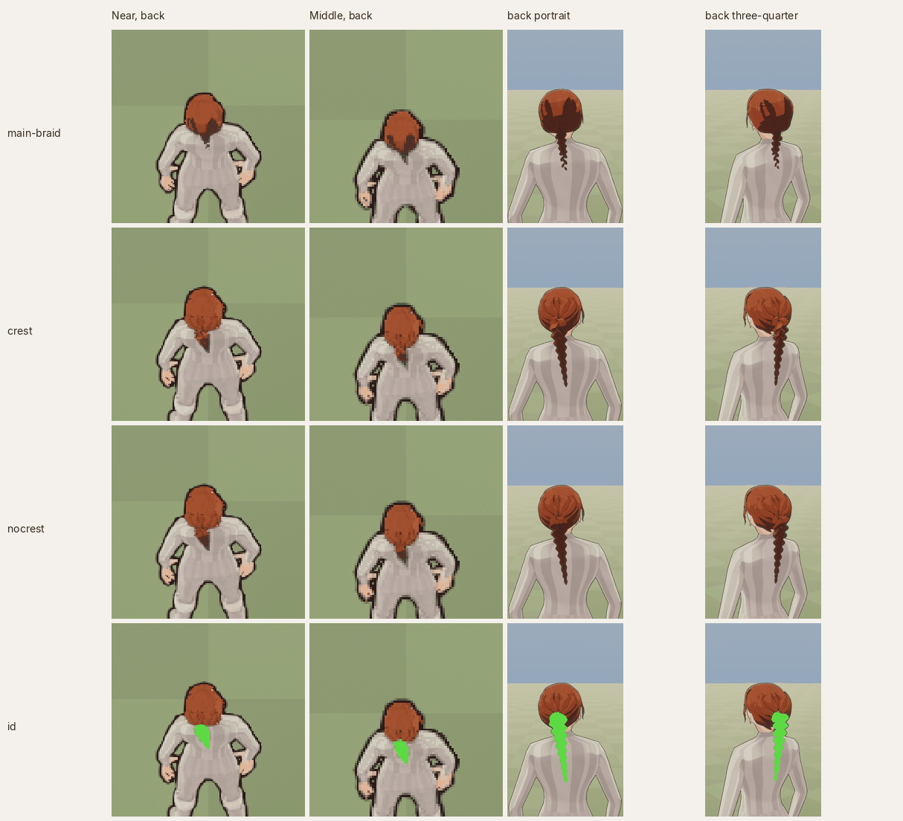
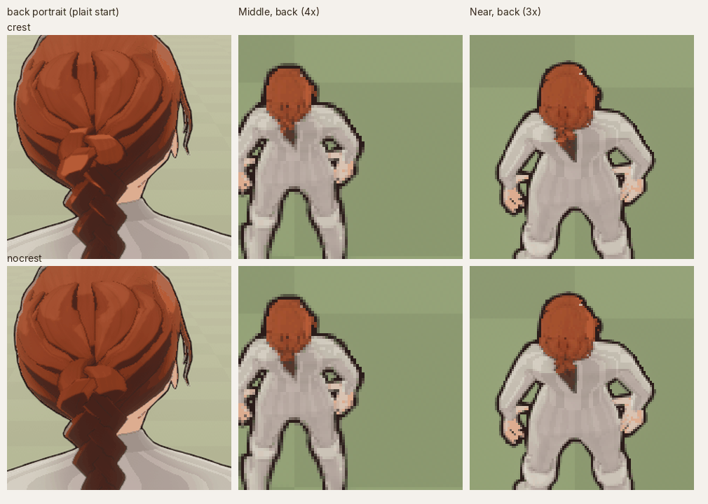

# char-port-2 · S6 · Step 1: the master's skeleton (checkpoint)

**Status:** step 1 of [the S6 plan](../../PLAN.md) §7. This is the checkpoint the coordinator asked for before the first full build. Nothing is built for the bundle yet. Everything is behind `SLOP_PORT=masters`, and with the flag off the generator writes exactly what main does (below).

## What is built

**`swept_braid`, Cora's cut as a parameter set** (`hair.MASTERS`, `Hair._swept_braid`), in the generator's own terms:

- **The hair mass:** drawn back to the plait's start, as the `braid` style's is (`gather`).
- **The rear layers** (`rear_layers`) are Cora's five layers (docs/char-live-3/back-hair/fit.py), each as six stations:
  - side distance in half-cheeks;
  - height above the chin in head heights;
  - width in half-cheeks.

  They are laid out as follows:
  - Each layer is Catmull-Rom between its stations, mirrored, and offset by her part asymmetry (0.065) and side tuck.
  - The layers lie 11 mm over the scalp, plus each layer's own swell.
  - Layers 3 and 4 carry a narrower companion beside the wide lock, as her secondary folds did.
  - They join the plait at staggered heights: layer 2 lowest, and the crown layer 6 high.
  - Each is a lock on an explicit path (`_path_ribbon`), shaded as her leaves were: the broad face one band, only the rolled margins turning to shadow.
- **The plait:** the generator's fitted three-strand plait (char-port-1) with Cora's plait parameters (`MASTERS[...]["plait"]`):
  - 2.9 turns, narrowing 63% to the tie;
  - the upper lobes widened 44%, falling to none before the tie;
  - its start 0.60 head heights above the chin, lifted 18 mm over the mass so the 58° camera sees it;
  - its radius 1.25 times the `braid` style's, which gives the drawn rear's width at both stops.
- **The crest,** without a second material: each crossing's upper face leans its normals up and its lower face down, and the top of each crossing takes a highlight (`hl_marks`, the per-vertex `_HIGHLIGHT`).
- **Still placeholders:** the front (the generator's swept fringe) and the jaw strands (temple locks). Step 2 brings Cora's front, hooks and side groups.

## Triangles (near mesh; budget 12,000 with the cap)

[triangles.json](triangles.json)

| Part | Triangles |
|---|---|
| Scalp cap | 1,216 |
| Hair mass | 1,980 |
| Rear layers (10 locks, 4 companions) | 2,272 |
| Plait (3 strands, binding and brush) | 1,588 |
| Front (placeholder) | 540 |
| Jaw strands (placeholder) | 336 |
| **Total** | **7,932** |

The far mesh is 3,194. That leaves about 4,000 for step 2's front, hooks and side groups.

## The back view: Near and Middle at 58°, a back portrait and a back three-quarter

[back-views.png](back-views.png) shows, top to bottom:
1. **main's `braid`:** S5's profile hair, on main;
2. **`swept_braid` with the crest;**
3. **`swept_braid` without the crest;**
4. **the plait's ID control,** the plait drawn green ([plait_id.py](../plait_id.py)).

Measured on the ID control ([back_views.py](../back_views.py); Cora's windows, 17 rows at Near and 10 at Middle from the plait's first row):

| | Near | Middle |
|---|---|---|
| First visible plait row (y, 1600×900) | **433** | **439** |
| Width, px (drawn rear 7.4 / 4.6) | **7.47 (+0.07)** | **5.00 (+0.40)** |
| Luma with the crest (drawn rear 69.1) | 76.1 | 83.5 |
| Luma without the crest | 73.1 | 81.2 |
| Cora's final plait, for reference | 86.0 | 89.1 |

- **Width:** within 0.5 px of the drawn rear at both stops.
- **Start:** the plait shows from the nape at both stops; its upper lobes sit below the head's outline from above.
- **Luma:** 10–20% over the drawing. That is lower than Cora's final, which was 25–30% over and which the GC asked to come down.

## Crest against no crest

[crest.png](crest.png):
- **Back portrait:** the crest reads. Each crossing's upper face is lit and the lower falls into shade, so the braid's start shows as interwoven lobes. Without it the start is one darker mass.
- **Near and Middle:** the difference is small, a lighter top to the first lobe, and +3 luma.
- **So shaped normals plus the per-vertex highlight carry the crest where it can be seen.** At play distance it neither helps nor costs much.

## Flag off

Ten styles built with main's generator (`origin/main` `b8c88d3fe`) and with this branch without `SLOP_PORT`:
- bob, long.2.collar, braid.3.collar.full, braids, balding.3, crop.cap, bun, tail.m, kerchief and shag.2.

**All ten are identical, JSON and binary,** and the file list is the same. The `braid` styles take the fitted plait's path through the new code unchanged.

## Not yet

These come in steps 2 to 4:
- Cora's front, hooks and side groups;
- the silhouette measures and tip counts;
- seeds and cuts;
- lock lines and the highlight rule on the rear layers;
- the fourth page;
- calibration, luma bins, shimmer and the audit.
