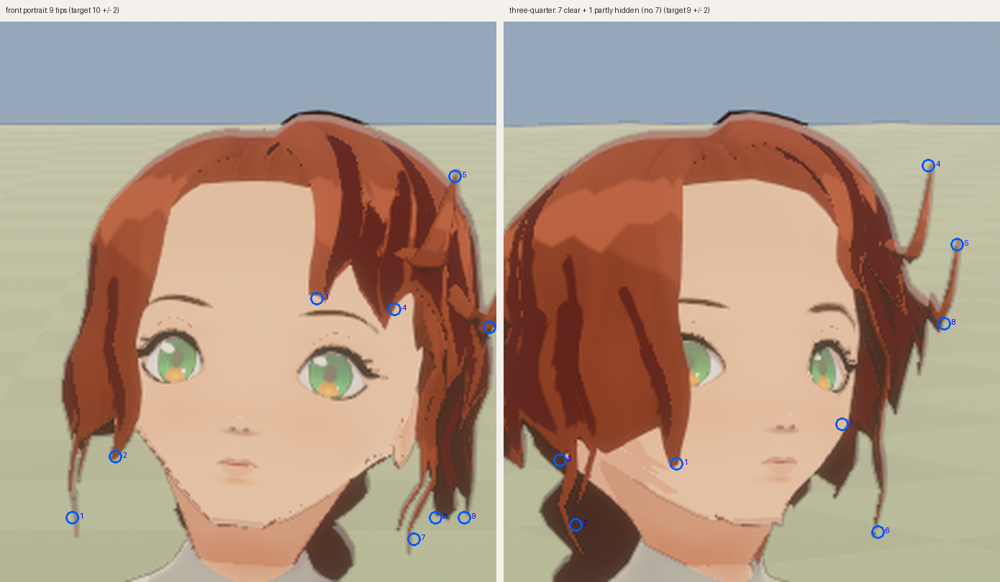
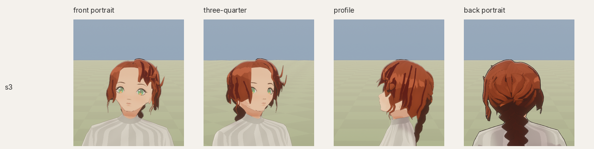
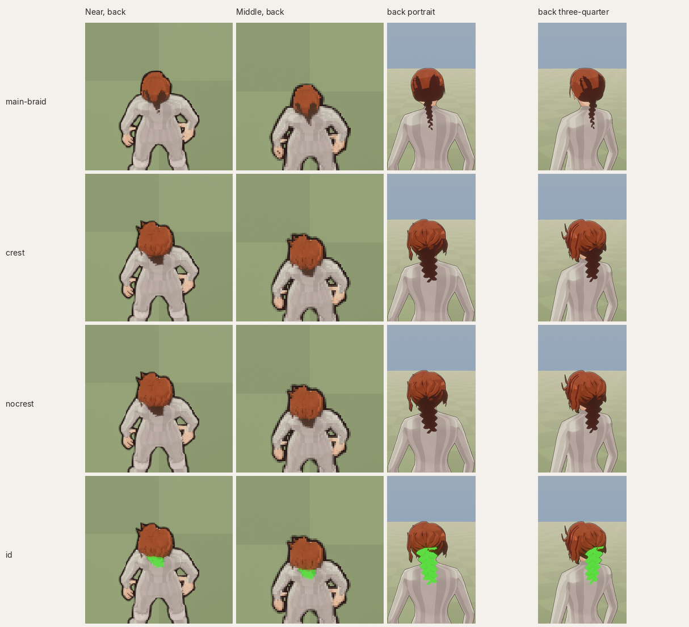

# char-port-2 · S6 · Step 2: Cora's front and the first full build

**Status:** step 2 of [the S6 plan](../../PLAN.md) §7. This is the first full build of `swept_braid` with Cora's front. It includes the silhouette measures and the tip counts. Everything is behind `SLOP_PORT=masters`. With the flag off, the generator writes exactly what main does (below).

The seeds and cuts, lock lines, the rear layers' highlight rule and the fourth page are step 3. Calibration, luma bins, shimmer and the audit are step 4.

## What is built

**Cora's front** (`hair.MASTERS["swept_braid"]["front"]`, `Hair.front_master`), in the generator's terms. The parting is 0.55 off centre, and the seed decides the side.
- **The sweep:** a 7-point section rooted up the part, from the hairline to the crown.
  - Its hem runs from the brow at the front to 0.40 head heights lower behind.
  - It crosses the forehead to the far side.
- **The near section:** 4 points, up the part too, falling to the near temple and down beside the face toward the jaw.
- **Two returning hooks** off the sweep's outer edge, at 62° and 80° round the head. Each is a lock on an explicit 4-point path (`explicit_lock`) that turns out and back up.
- **The jaw strands:** two long strands before each ear, to below the jaw.
- **Side groups:** two each side, over the ear and round behind it to the nape.
- **The front's points turn out from the head by 14 mm** (`flare`), which gives Cora's spread.

**The plait** (`MASTERS[...]["plait"]`) has changed since step 1:
- It is longer: 2.3 head heights, down the back to below the shoulder blades, as the drawing has it. In step 1 it ended at the shoulder blade and read as a wedge.
- It has 3.9 crossings, 0.59 head heights each.
- It sits lower on the hair under it, with a seat of 0.15 radii and 2 mm of lift.
- Its radius is 1.6 times the `braid` style's.

The pitch was the setting that moved the luma at the two stops apart most:
- 0.48 head heights per crossing gave 65.7 at Near and 79.6 at Middle (radius 1.7, seat 0.20);
- 0.70 gave 63.3 and 74.3;
- 0.59 gives 65.0 and 71.6.

## Silhouette (head frame, Cora's tolerances)

[shape.json](shape.json)

| Measure | Cora (target ± tolerance) | swept_braid | Set by |
|---|---|---|---|
| Spread (against this face's cheek width) | 1.87 ± 0.10 | **1.918** | the front, both sides |
| Crown lift | 0.096 ± 0.035 | **0.087** | the front |
| Rear depth | 0.53 ± 0.04 | **0.567** | the plait |

All three are within tolerance. Rear depth is near its upper limit (0.57): the plait's start sets it, so the plait's seat and lift are kept low.

The spread in Cora's own units (0.5076 head heights) is 2.24. This head's cheeks are wider than hers, so the spread against this face's cheeks is the one compared.

## Tips (char-live-2's method)

Tips are counted by eye on [front-close.png](front-close.png). A tip is an independent tapered endpoint visible at the outer silhouette or against the face. The braid, crown lobes and interior colour changes don't count.

| View | Target | Count |
|---|---|---|
| Front portrait | 10 ± 2 | **9** |
| Three-quarter | 9 ± 2 | **7 clear + 1 partly hidden** (no. 7) |

- **Front:** 9, counted as follows:
  - the two jaw strands on the near side (1, 2);
  - the sweep's point over the brow and the next lock's above the far eye (3, 4);
  - both hooks (5, 6);
  - three far jaw and side ends (7–9).
- **Three-quarter:** 7 clear tips, at the low end of the target. The near side's shorter tips merge into the side mass when turned, as they did in char-live-2's second fit. Step 3's cuts can add one sweep point if the GC wants it nearer 9.

## The front set and the back views

[front-views.png](front-views.png): front portrait, three-quarter, profile and back portrait.

[back-views.png](back-views.png), top to bottom:
1. main's `braid`;
2. `swept_braid` with the crest;
3. without the crest;
4. the plait's ID control.

In the back portrait, the plait now reaches mid-back. The rear layers gather into its start from both sides.

## The plait at play distance (Cora's windows, measured on the ID control)

[measure-crest.json](measure-crest.json) · [measure-nocrest.json](measure-nocrest.json)

| | Near | Middle |
|---|---|---|
| First visible plait row (y, 1600×900) | 436 | 441 |
| **Width, px** (drawn rear 7.4 / 4.6) | **7.24 (−0.16)** | **4.70 (+0.10)** |
| **Luma with the crest** (drawn rear 69.1) | **65.0 (−5.9%)** | **71.6 (+3.6%)** |
| Luma without the crest | 64.0 | 68.9 |
| Step 1, for reference | 76.1 | 83.5 |
| Cora's final, for reference | 86.0 | 89.1 |

- **Width:** within 0.5 px at both stops.
- **Luma:**
  - Middle is within 5% of the drawing.
  - Near is 0.6 below the band (65.6). The two stops differ by 6.6 against a band 6.9 wide, so a uniform shift can't put both well inside it.
  - Step 3's lock lines and highlight rule change the plait's shading, so I'll re-measure there and bring Near inside the band.

## Triangles (near mesh; budget 12,000 with the cap)

| Part | Triangles |
|---|---|
| Scalp cap | 1,216 |
| Hair mass | 1,948 |
| Rear layers (12 sections each; 14 in step 1) | 1,936 |
| Plait | 2,092 |
| Front (sweep, near section, hooks) | 3,308 |
| Jaw strands | 492 |
| Side groups | 608 |
| **Total** | **11,600** |

The far mesh is 4,312. 400 triangles are left under the budget for step 3. The rear layers went from 14 sections to 12 to make room, with no change in any measure above.

## Flag off

Ten styles were built with main's generator (`origin/main` `8e38f2953`) and with this branch, without `SLOP_PORT`:
- bob;
- long.2.collar;
- braid.3.collar.full;
- braids;
- balding.3;
- crop.cap;
- bun;
- tail.m;
- kerchief;
- shag.2.

**All ten are byte-identical, and the file list is the same.**

Main's generator ran from a copy at the same depth under the repository root as this branch's output. A copy elsewhere writes a different relative path to the shared `strands.png` (the JSON differs only there, and the binary is the same).

## Not yet

Step 3:
- seeds and cuts (`swept_braid`, `.2`, `.3`, `.collar`), with seeded variation clamped to the tolerances above;
- the fourth hair page;
- lock lines and the highlight rule on the rear layers and the front;
- the `pictures.py` fix that reads every `pages` entry;
- the plait's Near luma brought into the band.

Step 4: calibration by the S5 rule, the luma bins at Middle, shimmer, the audit and the package.
