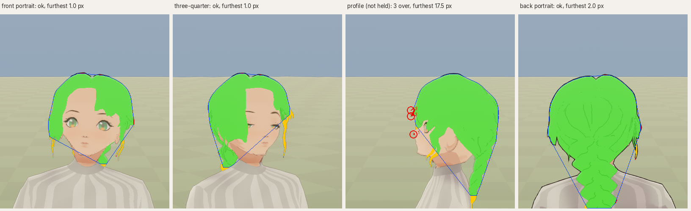
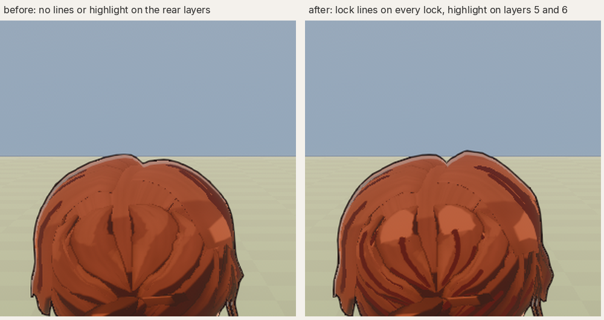

# char-port-2 · S6 · Step 3: flyaways, ears, cuts, lines, the fourth page

**Status:** step 3 of [the S6 plan](../../PLAN.md) §7, after the GC's step 2 review. Everything is behind `SLOP_PORT=masters`. With the flag off, the generator writes exactly what main does (below). Two points are open for the GC (last section).

## Flyaways (the GC's step 2 note) and the outline check

**The causes**, found on a parts ID render ([part_id.py](../part_id.py): each part in its own colour, by building the cut without it, `SLOP_MASTER_DROP`):
- **The hooks:** front portrait, right above the ear; the three-quarter's horn; the back's left poke. They turned out and up, their last point rising.
- **The sweep's long brow points:** the profile.
- **The near section's back corner, standing off the head:** the three-quarter.

**The fixes:**
- **The hooks return,** as char-live-2's "returning upper side hook": each bows out 2 cm, curls back under, and its tip lies on the hair 10–12° nearer the face.
- **The sweep's points are shorter** (depth 0.045 → 0.024, unevenness 0.45 → 0.30). They fall more steeply at the front.
- **The near section stands off 24 mm at the temple** (the sides' width) and 12 mm behind, toward the crown. Its points turn out only on the columns that reach the jaw.

**The check** ([back_views.py](../back_views.py) `outline`) runs on an all-hair ID render (`part_id.py --all`) of the front set:
- **The outline:** the convex hull of the hair's body, which is the hair with every part narrower than 15 px removed.
- **Hanging:** a piece outside the outline counts as hanging if it runs down from where it leaves the outline, within 35° of straight down (the jaw strands).
- **Pointing out:** any other piece points out. It fails if it reaches more than 4 px, about 4 mm at the portraits' scale, beyond the outline.
- **Not counted:**
  - specks under 4 pixels;
  - anything below the portrait's crop, where the plait hangs;
  - a piece that runs on past the crop's foot.
- **Held:** front, three-quarter and back, the GC's three. The profile is reported but not held.

[outline.png](outline.png) · [outline.json](outline.json): the outline in blue, hanging pieces in yellow, pieces pointing out in red (numbered when over the margin).

| View | Pieces over 4 px | Furthest |
|---|---|---|
| Front portrait | 0 | 1.0 px |
| Three-quarter | 0 | 1.0 px |
| Back portrait | 0 | 2.0 px |
| Profile (not held) | 3 | 17.5 px |

The profile's three pieces are:
- the sweep's fringe ends standing over the brow side-on (7 px);
- a 10-pixel sliver of the near section from the far side of the head, showing past the cheek (17.5 px).

## The ears are open

**Before:** the master covered both ears completely. char-port-1's ear rays found 0 of 3 open on every type, where main's `braid` leaves 2–3. Cora's drawing shows the ear in the three-quarter and the profile, with the side hair above and behind it.
- **What covered them:** dropping one part at a time, the sweep covered the far ear and the near section the near one. The mass, side groups, jaw strands and rear layers leave both open.

**Now** (`front.ear`):
- no section's hem falls below 22 mm over the eye line where it passes over the ear;
- the near section's columns from its middle back end there;
- its front columns fall to the jaw in front of the ear.

The ears are open, **3 of 3 rays on both sides on all nine female types** ([plait-fit.json](plait-fit.json)). The profile in [front-parts.png](front-parts.png) shows the ear.

## Cuts and seeded variation

A cut is the style from another seed, as for every style. `swept_braid` is cut 1, and `.2` and `.3` use seeds 2115 and 2215. Each is also written as `.collar`.

- **Cut 1 is the master itself,** with no variation. Step 2's measures and this step's tuning are on it.
- **Cuts `.2` and `.3` move these values by up to their ranges** (`MASTERS[...]["vary"]`, a draw per value from the seed):
  - the plait's length (keeping its pitch);
  - the sweep's drop and lean;
  - the hooks' place;
  - the near section's and the jaw strands' ends;
  - the flare and the part.
- **Clamped by measure** (`master_scale`): each cut is built at full range, and its silhouette is measured against Cora's tolerances and the triangle budget. If it fails, the range is halved, then quartered, then removed. **A cut out of tolerance even unvaried stops the build** and names its measures; it never ships quietly.

[cuts.json](cuts.json)

| Cut | Variation kept | Spread (1.87 ± 0.10) | Crown lift (0.096 ± 0.035) | Rear depth (0.53 ± 0.04) | Near triangles (≤ 12,000) |
|---|---|---|---|---|---|
| `swept_braid` (and `.collar`) | none: the master | **1.852** | **0.089** | **0.567** | 11,184 |
| `.2` (and `.collar`) | full | 1.780 | 0.094 | 0.567 | 11,052 |
| `.3` (and `.collar`) | half (full spread 1.766) | 1.770 | 0.089 | 0.567 | 10,412 |

`.2` and `.3` sit near the spread's lower edge. Both seeds put the part on the other side from cut 1, and the rear layers' asymmetry doesn't follow the part (first open point below).

## The plait's fit (char-port-1's checks) on nine women

**The test** ([measure_plait.py](../measure_plait.py)): char-port-1's measures, unchanged.
- **The women:** a coated woman of each female type from the island's book (adult, elder and youth; a, b and c), wearing each cut `.collar` with coat, jersey, trousers and boots.
- **The plait's root:** the last spring chain. Its weighted triangles match the plait's 2,092.

[plait-fit.json](plait-fit.json) · main's `braid` on the same women: [plait-fit-main-braid.json](plait-fit-main-braid.json)

| | swept_braid (27 fittings) | main's braid (27) |
|---|---|---|
| Plait triangles touching the coat's collar or upper back | **0** everywhere | 0 everywhere |
| Plait root to scalp | **≤ 0.91 mm** | ≤ 1.87 mm |
| Ear rays open, left / right (of 3) | **3 / 3** everywhere | 2–3 / 2–3 |

`swept_braid` isn't in `MAN_BACKED`: it lies on a woman's back only, as Cora's cut does.

## Lock lines and the highlight rule

- **Lock lines** are now on every lock, not only on sheets:
  - **Rear layers, hooks and side groups** (`_path_lines`): one line down each lock from the tip toward the root, and a shorter companion beside it on a wide lock. Each bends a little across and has its own random numbers, so the shape doesn't change.
  - **Sheets** keep their own lines, as S5 drew them.
- **The highlight rule** (`MASTERS[...]["highlight"]`) names the groups with a highlight: the rear layers 5 and 6, Cora's upper groups. Each gets a band along the lock, from 10% to 42% of its length, on the lock's face (`hl_marks`, R of the page). S5's highlight band on the upper hair (front and sides) applies to every lock as before.

## The fourth page

**The whole hair set** (92 files: the shipped styles and the six `swept_braid` files) built with `SLOP_PORT=hair,masters` and paged by `hair_page.py`:
- **four pages, 214 cells of 256** ([cuts.json](cuts.json) `pages`);
- `swept_braid`'s six files land on the third page (`hair-masks-2.png`);
- the fourth (`hair-masks-3.png`) holds 11 files of `tail` and `tousled`.

This build is from earlier in this step; `swept_braid`'s cells (24) haven't changed size since.

**The client takes the fourth page with no change:** main's client, with the four-page set installed:
- **`swept_braid` (page 3) and `tail.3` (page 4)** both draw their bands and lines;
- **0 ERROR and no `handmade` warnings** ([pages4.png](pages4.png));
- **the installed assets put back** afterwards and compared byte for byte.

S7's cost budget takes four hair materials.

**`pictures.py`** (the manifest pass's gap) now reads every entry of the page manifest's `pages`, not only its first `page` and `files`. Tested on S5's three-page set:
- complete: no fails;
- with the third page's picture and one of its files removed: both named.

## The plait at play distance

[measure-crest.json](measure-crest.json) · [measure-nocrest.json](measure-nocrest.json) · [back-views.png](back-views.png)

| | Near | Middle |
|---|---|---|
| Width, px (drawn 7.4 / 4.6) | **7.24 (−0.16)** | **4.60 (0.00)** |
| Luma with the crest (drawn 69.1) | **66.0 (−4.5%)** | **72.1 (+4.3%)** |
| Luma without the crest | 64.5 | 69.6 |
| Step 2 | 65.0 (−5.9%) | 71.6 (+3.6%) |

Both stops are now within 5% of the drawing:
- the lobes' lower faces turn down less (`crest_up` −0.30 → −0.28);
- the crest's highlight is weaker (`crest_lit` facing 0.60 → 0.45).

The two stops stay about 6.5 apart at every setting tried, so a single shift places them in a band 6.9 wide.

The near section's stand-off behind is held at 12 mm. More hides the plait's start from the 58° camera: at 19 mm the Middle measure read 4.9–5.2 px and 75 luma.

## Tips

[tips.png](tips.png), counted by char-live-2's method: independent tapered ends at the silhouette or against the face; the braid, crown lobes and colour changes are excluded.

| View | Target | Step 2 | Now |
|---|---|---|---|
| Front portrait | 10 ± 2 | 9 | **8** |
| Three-quarter | 9 ± 2 | 7 + 1 | **6** |

**Three-quarter is one short** (second open point below). The ear opening and the shorter, steadier points took tips:
- the near section's points that hung over the ear;
- the sweep's long brow points.

A fifth point on the near section (not the sweep, per the GC) gives the tip back, but costs spread: `.2` and `.3` fell to 1.757 and 1.766 and stopped the build. So I haven't added it.

## Triangles

| Part | Near triangles |
|---|---|
| Scalp cap | 1,216 |
| Hair mass | 1,948 |
| Rear layers | 1,936 |
| Plait | 2,092 |
| Sweep | 1,504 |
| Near section | 1,084 |
| Hooks | 304 |
| Jaw strands | 492 |
| Side groups | 608 |
| **Total (cut 1)** | **11,184** |

## Flag off

The same ten styles as step 2 were built with main's generator (`origin/main` `6f3f29e30`, whose generator is unchanged since `8e38f2953`) and with this branch, without `SLOP_PORT`:
- bob;
- long.2.collar;
- braid.3.collar.full;
- braids;
- balding.3;
- crop.cap;
- bun;
- tail.m;
- kerchief;
- shag.2.

**All ten are byte-identical, and the file list is the same.**

The new switches in `hair.py` are all inert without the flag:
- `MASTER_DROP`;
- the callable `lift` and `tip_out` of a sheet;
- `_vary_scale`, which `person_params.resolve` passes only when given.

## Step 0's verify-ui timings (main `b8c88d3fe`, 2026-11-20, local time)

**Sources:**
- **Logged:** cargo's own time and the launch's own measure.
- **Estimated:** the rest is the wall time of each command, from the session's records, checked against the evidence files' times.

| Stage | Time | Source |
|---|---|---|
| Scratch server start (`s6ui-stdb`) | 3 s | wall time (20:55:08–20:55:11) |
| World setup: authority module build, publish, island genesis (40 steps) | 46 s, of which the module build ~32 s and publish + genesis ~14 s | wall time (20:55:18–20:56:04); the split from the wasm's file time (20:55:50) |
| World setup with the module cached (the `hair-orphans` rerun) | 13 s | logged by the launch |
| **Client build** (`cargo build --release -p living-game`, sccache), separate | **2 min 07 s** | logged by cargo |
| **`hair` scenario** (11 checks) | **38 s** wall; evidence files written over 28 s | wall time (20:59:15–20:59:53); file times 21:01:50–21:02:18 and 21:06:56–21:07:24 on the reruns |
| **People drive** (six residents, Middle and Near) | **25–27 s** each | file times: shipped 21:03:08–21:03:34, S5 21:00:50–21:01:15, after the prune 21:06:22–21:06:48; wall 27 s |
| The whole step 0, server start to the last check, with the client build | 8 min 29 s | 20:55:08–21:03:37 |

## Open points for the GC

1. **The part side and the rear layers.**
   - **What happens:** the seed decides the side of the part, as for the other styles. Cut 1 parts on one side (parting +0.08), and `.2` and `.3` on the other (−1.0 and −0.04). The rear layers' asymmetry (Cora's part offset and side tuck) is fixed in her frame and doesn't follow the part, so the mirrored cuts get a narrower back. That is why they sit 0.07 under cut 1's spread.
   - **Also:** cut 1's sweep goes to the character's left, and in Cora's drawing it goes to her right.
   - **Proposed:** make the rear layers follow the part, and put cut 1 on Cora's side. Then re-tune the spread on the consistent cut, which is likely the narrower one now that the ears are open.
   - **The choice for you:** with the ears open, Cora's spread (1.87, measured on her fit with the ears covered) may not be reachable without flyaways or a ledge. Should the spread tolerance be re-measured with the ear open, or should I find the width elsewhere?
2. **Three-quarter tips 6** against 9 ± 2. It can come back:
   - with a fifth near-section point once the spread has room (point 1);
   - or by counting a hook end that shows only partly.

   Your call, together with point 1.

## Not yet

Step 4: calibration by the S5 rule, the luma bins at Middle, shimmer at the three stops, the audit, flag-off and the package (the bundle with the four pages).
