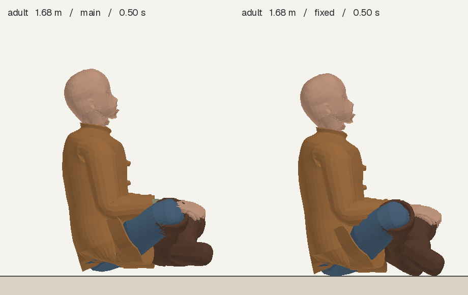
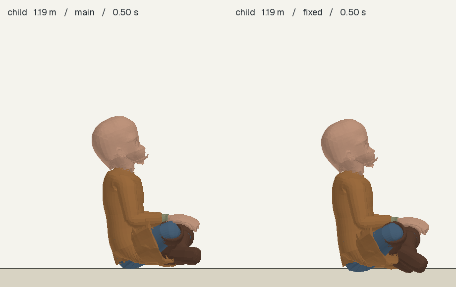
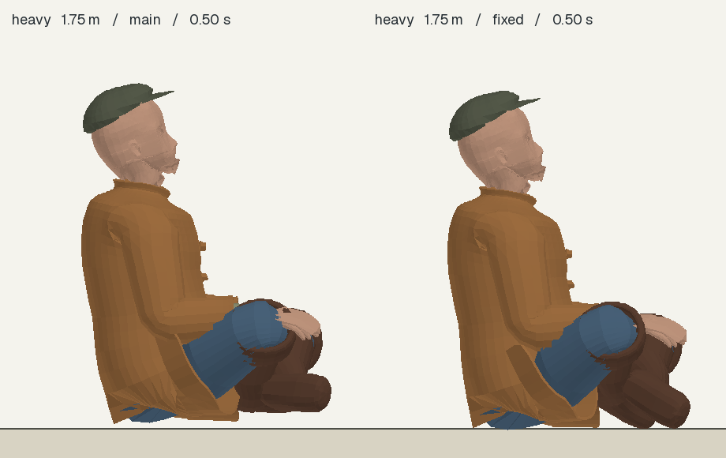

# Ground-sitting clip bake

Both libraries were regenerated on the near male reference with the same Blender shim, the same 84 picked library entries and main at `9cb3b15bf`. The source loop flags left heel contact on 240/240 frames and right heel contact on 239/240. Main’s straight-foot contact markers found no intervals on either rolled boot. Its torso guard lifted the pelvis and feet together by up to 51.2 mm.

The three ground entries now use frame 45 of `sit_ground_pose_s1.npz`. The bake skins the weighted soles and seat, solves the legs against the floor and shares the resulting lower-body pose at both joins. It keeps the upper-body performance and measures the rolled sole for contact markers. During the transitions, source contacts guide each boot and source pelvis height engages the seat.

## Bake reference

The [main](main-reference.csv) and [fixed](fixed-reference.csv) samples cover every exported frame of all six sitting clips at 30 Hz. Signed heights are model millimetres. The seat region uses the dominant hips or upper-leg weight on the reference clothing mesh. The lowest seated vertex is hips-weighted.

| Seated loop, 240 frames | Main | Fixed |
|---|---:|---:|
| Pelvis | +169.2 to +188.9 | +157.2 |
| Left boot | -18.3 to +48.5 | +0.0 |
| Right boot | -14.0 to +45.6 | +0.0 |
| Seat | +10.5 to +31.3 | +0.0 |

Both boots now mark normalized time 0–1 as planted. The down-to-loop and loop-to-rise poses agree within 0.001° and 0.001 mm. The loop closes to export precision. Peak change in the per-frame angular step falls from 14.19° to 7.96° on descent and from 8.61° to 3.92° on rise. The largest hip steps stay at 39.59 mm and 44.16 mm respectively. All three chair clips already mark both feet planted throughout. Their idle soles span −1.6 to +1.3 mm. The descent and rise have brief penetrations to −8.9 and −9.7 mm. [All planted intervals](contacts.json) · [Per-animation channel hashes](library-diff.csv)

## Fitted bodies

These ranges use 16 evenly spaced loop samples at the actual client hip multiplier, the pre-shape fitted bounds from `cloth_check.py` at `f8726755` and the fitted root scale. Values are signed world millimetres for the lowest boot and trousers vertices.

| Body | Boots, main | Boots, fixed | Trousers, main | Trousers, fixed |
|---|---:|---:|---:|---:|
| Short child, 1.19 m | -30.3 to +16.3 | -19.9 | -9.5 to -0.9 | -16.8 |
| Average adult, 1.68 m | -17.1 to +41.9 | -0.2 | +10.0 to +23.1 | -1.3 |
| Tall adult, 1.90 m | -19.3 to +47.1 | +0.1 | +14.8 to +30.1 | +2.1 |
| Heavy adult, 1.75 m, build 1.23 | -17.9 to +44.2 | -0.6 | +7.5 to +20.9 | -4.2 |

[Main fitted samples](main-types.csv) · [Fixed fitted samples](fixed-types.csv)

## Garment penetration

Maximum garment penetration from `--seat-contact --frames 16`, including springs. Each cell gives main → fixed, in the tool’s model millimetres. Multiply the child values by 0.71523, coat-f by 0.91935 and coat-m by 0.93024 for world millimetres. The unity control overrides only the multiplier returned by the fitted tool.

| Garment and hip scale | Descent | Loop | Rise |
|---|---:|---:|---:|
| coat-f-actual | 17.9 → 17.6 | 7.1 → 12.9 | 50.7 → 41.7 |
| coat-m-actual | 6.0 → 6.9 | 0.0 → 0.0 | 28.3 → 10.0 |
| child-actual | 27.7 → 26.9 | 3.4 → 6.5 | 56.1 → 39.4 |
| child-unity | 0.0 → 0.0 | 0.0 → 0.0 | 25.8 → 8.7 |

On the final rise, the child’s smock peaks at 28.2 mm below ground in world space with the actual hip scale and 6.2 mm with unity. Main measured 40.1 and 18.5 mm. The remaining garment penetration and the deeper seated coat-f hem are visible limitations.

The 1.19 m child uses `hips_k=0.843868`. The client's placement of it is fixed on branch `sit-hips` ([sit-hips.md](../sit-hips.md)): seated boots −2.4 mm and trousers +0.8 mm, and the rise's smock −9.9 mm. [Main](main-child-rise.csv) and [fixed](fixed-child-rise.csv) give all 75 rise frames for both multipliers, including rigid boot, trousers and smock heights in world millimetres. The spring-enabled garment peaks above are sampled separately.

## Side views

Each pair shows main on the left and the fixed loop on the right at 0.50 s. They use the fitted root and projected skinned meshes with flat materials and rigid cloth. Horizontal lines mark terrain. These are offline side views. Game-renderer playback, slopes, chair geometry and the combined scene gate are outside this measurement.

