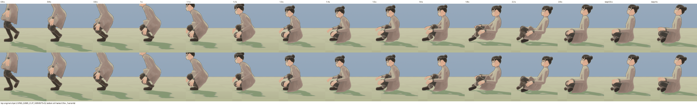
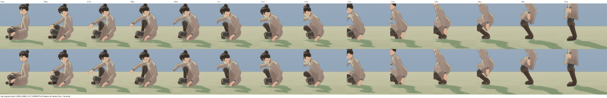

# The female ground-sit selector (sit-f-select)

Status: **built on branch `sit-f-select`** (2026-11-19, from main `8851982d2`), not merged. Client-only: `living/game/src/anim.rs`, `view.rs`, `live.rs` (a log line), `gait.rs` (a feet-log field), the rule file `living/game/assets/characters/clip_variants.json`, and the measuring tool `living/tools/characters/cloth_check.py`. It makes no server read, write, subscription or authority change, so no SpacetimeDB feature is involved.

The spec is dev-box's [female ground bake](female-ground-bake/README.md), "Laptop playback selector". That bake put three variants beside the originals in the shared clip file: `sit_ground_down_f`, `sit_ground_f` and `stand_up_ground_f`.

## The rule

**Where it lives:** `living/game/assets/characters/clip_variants.json`, one family:

| Field | Value |
| --- | --- |
| `types` | `adult-` (a type id prefix) |
| `wears` | `trousers-f` and `boots-f`, both |
| `clips` | `sit_ground_down` → `sit_ground_down_f`, `sit_ground` → `sit_ground_f`, `stand_up_ground` → `stand_up_ground_f` |

- **Who:** a generated adult (a composed person line whose type starts `adult-`) wearing both pieces. Children, youths, elders and the male family keep the originals.
- **Why the elders keep theirs:** dev-box's elder-woman trial improved her seated contact but deepened her boots on the rise.
- **Pieces, not form:** the pieces worn decide, so a form override that puts an adult in the female trousers and boots gets the variants.
- **One source:** the client compiles the file in (`include_str!`, `anim::families`). `cloth_check.py --ground-clips select` reads the same file. `check.py seat` reads it too, to know what each resident should play.

## How the client applies it

The selection is a resolve step, from logical name to animation, per character. It is not a rename.

- **When:** when a body's clips are bound (`anim::build`, as the `Anim` is made). The body's variants come from its `Character` recipe's person line type and the pieces it is composed wearing (`compose::Styled`, so the geometry actually drawn: `anim::variants_of`). They are kept on the `Anim` (`plays`).
- **Never switched:** a body never changes from original to variant while it plays, so no pose jumps from the selection. A body redrawn for a new look is a new body and binds its own.
- **What resolves:** the graph node played (`set.full`, `set.upper`), the clip's length, and the feet's marker contacts for IK (the variant's own sidecar entry). All go through `anim::resolve`.
- **What keeps the logical name:**
  - the cloth's ground contact weight (`seat_of`, `Anim::ground_seat`);
  - sit-hips' ground share and blend (`Anim::ground_share`, `ground_hips`);
  - seat-2a's anchor timing (`live.rs`);
  - `town::Show`'s sitting state;
  - the recordings' `showing`, the feet log's `clip`;
  - and verify-ui.
- **Fallback:** variants the body's clip file lacks are dropped at binding, silently, so an older bundle plays the originals.
- **The asset view:** a shot of a logical clip (`sit_ground@1.0`) plays the model's variant (`view::Item::played`). A shot that names a variant (`sit_ground_f@1.0`) is still seated on the checker (`anim::logical`).
- **The switch:** `LIVING_GAME_CLIP_VARIANTS=0` makes every body play the logical clips, as before. It is for A/B runs on one binary.
- **Logs:**
  - `seat: #ID sits on the ground at (…), normal (…), plays sit_ground_f` names what a sitter's loop plays.
  - The asset view logs `view: FILE plays [(…)]` for a model with variants.
  - The feet log (`LIVING_GAME_FEET`) now also carries `hips_at`, the hips' world place.

## Result

### cloth_check, fitted bounds, `--terrain`

32 samples a clip, `--ground-hips height` (sit-hips), lines from play-test 10's look book, the worktree's rebake. Signed seated heights over the terrain, world mm, logical clips → the client's selection. [Per clip: heights.csv](sit-f-select/heights.csv).

| Body | Line | Boots | Trousers |
| --- | --- | ---: | ---: |
| Average woman 1.68 m | `lk_951d41ff6df19fc2`, adult-f-b | +14.91 → −0.02 | +30.25 → +0.54 |
| Short woman 1.55 m | `lk_0da9fb451adc01ff`, adult-f-c | +13.95 → +0.06 | +29.29 → +1.88 |
| Average man 1.74 m | `lk_05dca30256f0fdbc`, adult-m-a | +0.01 → +0.01 | +0.51 → +0.51 |
| Child 1.19 m | `lk_00a7d64a62adc17c`, child-u-c | −2.37 → −2.37 | +0.80 → +0.80 |
| Elder woman 1.69 m | `lk_006c998721c64f14`, elder-f-b | +16.43 → +16.43 | +31.23 → +31.23 |
| Elder man 1.81 m | `lk_01dc95d5bd934cd0`, elder-m-b | −0.35 → −0.35 | −2.26 → −2.26 |

- **The women:** every row of the two women's descent, loop and rise equals dev-box's [family trial](female-ground-bake/family-trial.csv) to the hundredth of a millimetre.
- **Everyone else:** the man's, child's and both elders' height CSVs are byte-identical between `--ground-clips original` and `select`.
- **The rise's boots** go slightly deeper with the variants: average −0.31 → −0.43, short −1.24 → −3.09.

With springs and the seat contact (`--seat-contact`, 16 samples), [seat-contact.csv](sit-f-select/seat-contact.csv):

- **The smock hems (dev-box's known remainder):** seated −22.56 / −13.23 mm below the terrain (average / short), against +6.53 / +13.62 on the originals. The rise's lowest goes from −23.88 to −49.97 and from −21.07 to −33.51. These are dev-box's figures. It is garment work, on dev-box.
- **Gaits:** walk, brisk walk and run results are identical between the arms for all six bodies.

### In the client (asset view, one binary, selector on and off)

`LIVING_GAME_VIEW=look:<key>`, side view, 29 ground-clip shots (descent, loop, rise) and 18 gait shots a body, with `LIVING_GAME_VIEW_JOINTS`. [Joint comparison](sit-f-select/client-joints-on-vs-off.txt).

- **Male, child, both elders:** every `J_Bip_*` joint in every shot is byte-identical with the selector on and off. Spring joints (hair, skirts) differ by at most 0.02 mm, the child's in the descent: frame timing, as two runs of one binary do.
- **Gaits:** in walk, brisk walk and run, every `J_Bip_*` joint is byte-identical for all six bodies; spring joints differ by at most 0.00013 mm.
- **The women** differ only in the ground clips, by up to 39 mm (average) and 36 mm (short). The standing ends are identical: 4 of 13 descent shots and 4 of 14 rise shots.
- **Against the tool:** both women's 29 ground-clip rows agree with `cloth_check.py --compare-client` (`--ground-clips select`) within 0.0001 mm on the root, the hips and both feet. The selector-off rows agree with `--ground-clips original` the same way. Against the wrong clips they differ by 36 mm, so the comparison is sensitive.

### No pop

The average woman in the asset view, the originals above and the variants below:

Sitting down, `sit_ground_down` 0.6–2.9 s and the loop:

Getting up, `stand_up_ground` 0.4–2.2 s of clip:

- **The stills:** the seated body rests lower on the checker. The descent runs into the loop and the rise out of it without a step. The standing ends match the originals.
- **Live, frame by frame:** `check.py seat` follows one variant sitter in the feet log. The same resident (#2) was also run with the selector off, on the same world. Peak speed of the hips and feet from the root, m/s, in the 0.12 s crossfade in and after it:

| Segment | Variants | Originals |
| --- | --- | --- |
| Sitting down (from standing) | 4.56 / 3.40 | 4.97 / 22.22 |
| Getting up (from the loop) | 3.49 / 2.83 | 3.50 / 3.01 |

- **The peaks:** the crossfade from standing into the clip is the fast part in both arms. The variants add no peak.
- **The seat, live:** the variant sitter's hips rest 0.1107 m over the ground through the loop, against 0.1388 m on the originals. That is 28 mm lower, as the trousers' +30 → +0.5 mm says.

### Found on the way (main's behaviour, both arms)

In `check.py seat`, when the camera goes far (`notches:-30`), a seated resident starts `stand_up_ground` and is set back to `sit_ground_down` 0.19 s later (#2 at 25.84 → 26.03 s in both runs). The interrupted rise crossfades to the descent's standing start in 0.09 s, a visible jump (9 m/s at the feet). It is the far/near path's, not the clips'. It is not fixed here.

## The clips

- **The rebake:** `KIMODO_DIR=/Users/carlid/dev/slop-art-online/.local/kimodo/library ONLY=present LOD=near living/tools/blender/gen_person.sh clips=man`, in the worktree. It baked 84 entries, none missing. The female seat mesh was built by the bake itself.
- **The file:** 87 animations.
- **The originals:** the 84 are identical in channels (node, path, interpolation, key times and values) and animation metadata to the sit-hips rebake at `c39a33ee5` ([hashes](sit-f-select/rebake-vs-c39a33ee5.csv)).
- **The variants:** same length as their originals (2.967, 7.967 and 2.467 s). Their sidecar entries differ only in the bake's floor measures and the foot markers.
- **The skeleton:** `skeleton_check.py` reported 196 files, 0 with a bone at another place.

## The tool

`cloth_check.py --ground-clips select|original|variant` chooses the animation a logical clip plays:

- `select` (default): the client's rule from `clip_variants.json` on the line's type and pieces.
- `original`: the logical clips, main before this branch.
- `variant`: every family's variant whatever the line, dev-box's measurement copy.

Rates, contact timing, the hips' rule and printed names stay logical. `--compare-client` resolves the same way.

## Not covered

- **Slopes:** the asset view and `cloth_check` use a flat floor.
- **The smock hems under the terrain** with the variants: dev-box's garment work.
- **A real window:** the runs were headless.
- **Frame time:** no claim; the change resolves a name a body binds once.
