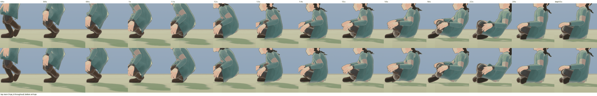
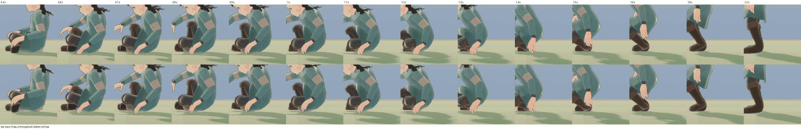

# Ground sitting on short and long legs (sit-hips)

Status: **built on branch `sit-hips`** (2026-11-19, from main `c39a33ee5`), not merged. Client-only: `living/game/src/anim.rs` and `characters.rs`, and the measuring tool `living/tools/characters/cloth_check.py`. It makes no server read, write, subscription or authority change, so no SpacetimeDB feature is involved.

## The fault

`characters::hips` scales the clip's hips translation by `hips_k`, the leg chain's length against the base's, so that a standing body's feet reach the ground. A ground sit rests on the seat under the pelvis, not on the legs. The hips bone keeps its height in `bone_scale`, so the seat below the pelvis is not scaled with the legs.

- **The child:** at `hips_k` 0.844, the 1.19 m child's seated pelvis was drawn 17.5 mm (world) too low. Its boots sat 19.9 mm and its trousers 16.7 mm under the ground.
- **Long legs:** an elder with legs 1.075 (`hips_k` 1.056) was drawn 8 mm too high.

## The change

In the ground seat's clips, the hips' **height** is scaled from `hips_k` toward 1 as far as the clip has the pelvis down at the seat. Across and along, the hips keep `hips_k`.

- **The rule:** `k_y = hips_k + (1 − hips_k) · share · ground_hips(y, rest)`.
- **`share`:** the ground clips' share of the pose, whatever their time (`Anim::ground_share`). It is weighted as `Anim::ground_seat` is (one-shots over the standing loop, the loop as far as the body is out of its gait), and both now use one helper, `Anim::by_clips`.
- **`ground_hips`:** a smoothstep of the clip's own hips height `y` against their rest height. It is 1 at or below 0.17 of rest and 0 at or above 0.45 of rest (`anim::GROUND_HIPS`). The shared clips' seated loop has the hips at 0.160 of rest (0.1572 of 0.985).
- **Outside the ground clips** (`share` 0) the code path is today's `translation * hips_k`, so standing, walking and running are unchanged.
- **The asset view** poses without `anim.rs`. A body there is in a ground clip while it carries a `SeatAnchor` with a weight, which the view sets for a ground clip's shot.

### Why the clip's height and not the cloth contact's clip time

The brief recommended reusing seat-2a's clip-time weight. Measured on the child, it is the wrong timing for the pelvis:

- **The seat:** in `sit_ground_down` the hips reach seat height only at about 1.4 s (0.524 at 1.0 s, 0.296 at 1.2 s, 0.165 at 1.4 s). In `stand_up_ground` they stay near the seat until about 1.15 s, then rise.
- **The descent:** the contact weight is full from 1.2 s, while the feet still carry the body in a deep squat.
- **The rise:** the contact weight stays full until 1.3 s, then fades over 0.32 s of clip, while the feet carry the body up.

So at unity the shortened legs lift the planted boots off the ground. With the clip-time weight, the child's boots float up to +17.6 mm on the descent and +26.0 mm on the rise (`cloth_check --ground-hips contact`).

The height weight follows what the clip actually does:

- **The edges:** it is 0 wherever the ground clips begin and end standing, so nothing jumps as they blend in or out.
- **The offset:** the offset it adds (at most 22.3 mm on the child) comes in while the clip's own pelvis falls at up to 700 mm/s, and goes out while it rises at up to 1,280 mm/s. The offset changes by at most 3.1 mm a 60 Hz frame on the descent and 4.2 mm on the rise.
- **Peak pelvis speed:** unchanged. It is 699.5 mm/s against 701.6 on main for the descent, and 1,278.9 for the rise. The clip-time weight raised the descent's peak to 772.0.

The alternative of scaling by the pelvis's seat depth comes to the same target. The seat depth is the hips bone's height scale, and that is 1, so it agrees with blending toward 1. The open question was only when to blend, and that is settled above.

### The band

The lower bound, 0.17, clears the seated loop's 0.160, so the loop is fully at unity.

The upper bound was swept on the child with `--ground-hips-band 0.17,HI`. Each cell gives the worst smock depth on the rise, then the range of the lowest of boots and trousers between 0.6 and 1.6 s of the rise:

| HI | Rise smock | Support 0.6–1.6 s | Descent smock |
| ---: | ---: | --- | ---: |
| 0.24 | −24.2 | −11.0 to +6.2 | −15.8 |
| 0.30 | −17.6 | −8.8 to +6.7 | −13.3 |
| 0.36 | −12.6 | −8.1 to +7.5 | −6.2 |
| **0.45** | **−9.9** | **−6.5 to +11.9** | **+0.3** |
| 0.55 | −8.7 | −6.3 to +15.1 | +0.3 |
| 0.70 | −8.0 | −2.8 to +19.8 | +0.3 |

At 0.45 the descent's smock comes out of the ground entirely. The rise's smock depth gets 18.8 mm of the 22 mm `hips_k` share back, and the boots lift at most 11.9 mm while they carry the body. A higher bound buys about 2 mm more smock for 3–8 mm more float.

## Result

Measured with `cloth_check.py --terrain --seat-contact` on the fitted bounds, 60 poses a clip, springs simulated, `stand_up_ground` at 1.6. Lines come from play-test 10's look book, and clips from this branch's rebake (below). Each cell gives the lowest point over the clip in world mm against the terrain, main → sit-hips (negative is under). "Garment" is the lowest skirted piece: smock, apron or coat.

| Body | hips_k | Clip | Boots | Trousers | Garment |
| --- | ---: | --- | ---: | ---: | ---: |
| Child 1.19 m (`lk_00a7d64a62adc17c`, smock_58-m) | 0.8439 | `sit_ground_down` | −20.7 → −14.9 | −16.7 → +0.8 | −19.2 → +0.3 |
| | | `sit_ground` | −19.9 → −2.4 | −16.7 → +0.8 | −4.6 → +12.9 |
| | | `stand_up_ground` | −19.9 → −9.5 | −16.7 → +0.8 | −28.7 → −9.9 |
| Average adult m 1.74 (`lk_05dca30256f0fdbc`, smock_74-m) | 1.0000 | `sit_ground_down` | −0.4 → −0.4 | +0.5 → +0.5 | +20.8 → +20.8 |
| | | `sit_ground` | +0.0 → +0.0 | +0.5 → +0.5 | +29.6 → +29.6 |
| | | `stand_up_ground` | −0.7 → −0.7 | +0.5 → +0.5 | +12.1 → +12.1 |
| Average adult f 1.68 (`lk_951d41ff6df19fc2`, smock_58-f) | 0.9914 | `sit_ground_down` | −0.0 → −0.0 | +26.3 → +27.6 | −16.9 → −15.5 |
| | | `sit_ground` | +13.6 → +14.9 | +29.0 → +30.3 | +5.3 → +6.5 |
| | | `stand_up_ground` | −0.4 → −0.4 | +20.2 → +21.5 | −28.6 → −27.0 |
| Tall adult 1.90 (`lk_0a014825e0578b4c`, smock_74-m) | 1.0000 | `sit_ground_down` | −2.3 → −2.3 | +2.1 → +2.1 | +29.0 → +29.0 |
| | | `sit_ground` | +0.1 → +0.1 | +2.1 → +2.1 | +37.3 → +37.3 |
| | | `stand_up_ground` | −3.5 → −3.5 | +2.1 → +2.1 | +20.6 → +20.6 |
| Heavy adult 1.75, build 1.23 (`lk_5932fb7176b109b9`, coat-m) | 1.0000 | `sit_ground_down` | −3.2 → −3.2 | −5.4 → −5.4 | −22.1 → −22.1 |
| | | `sit_ground` | −0.6 → −0.6 | −4.2 → −4.2 | +2.0 → +2.0 |
| | | `stand_up_ground` | −10.0 → −10.0 | −5.4 → −5.4 | −29.9 → −29.9 |
| Short adult f 1.55 (`lk_0da9fb451adc01ff`, smock_58-f + apron) | 0.9914 | `sit_ground_down` | −0.5 → −0.5 | +28.1 → +29.3 | −5.4 → −4.1 |
| | | `sit_ground` | +12.8 → +13.9 | +28.1 → +29.3 | +12.5 → +13.6 |
| | | `stand_up_ground` | −1.2 → −1.2 | +25.3 → +26.5 | −21.3 → −21.2 |
| Elder f 1.69, legs 1.075 (`lk_006c998721c64f14`, smock_50-f + apron) | 1.0557 | `sit_ground_down` | −0.2 → −0.2 | +37.5 → +28.8 | −10.4 → −19.9 |
| | | `sit_ground` | +24.7 → +16.4 | +39.5 → +31.2 | +18.2 → +9.9 |
| | | `stand_up_ground` | −1.2 → −2.5 | +32.3 → +23.6 | −41.5 → −45.2 |
| Elder m 1.81 (`lk_01dc95d5bd934cd0`, smock_74-m) | 1.0000 | `sit_ground_down` | −1.8 → −1.8 | −2.8 → −2.8 | +7.8 → +7.8 |
| | | `sit_ground` | −0.3 → −0.3 | −2.3 → −2.3 | +22.2 → +22.2 |
| | | `stand_up_ground` | −5.8 → −5.8 | −2.9 → −2.9 | −0.6 → −0.6 |

Per-pose data: [summary](sit-hips/summary.csv), and the child's 60-pose clips on [main](sit-hips/child-main.csv) and [sit-hips](sit-hips/child-fixed.csv).

### The child

- **Seated:** trousers at +0.8 mm and boots at −2.4 mm. The target was ≤ 2 mm below, so the boots miss it by 0.4 mm.
  - That 2.4 mm is the folded short legs' own geometry, not the hips: the seat (trousers) is on the ground.
  - The pelvis is at 112.4 mm, against 94.9 on main.
- **The rise's smock:** −28.7 → −9.9 mm, 18.8 mm of the 22 mm `hips_k` share. The unity control (`hips_k` 1 throughout) measured −6.2 at the bake, but that floats the boots while they carry the body.
- **The descent's smock** comes out of the ground: −19.2 → +0.3 mm.
- **What remains in the descent:** the boots at −14.9 mm between 0.78 and 1.2 s. That is the squat before the seat touches, where `hips_k` is still the legs' and unchanged. Main has −12 to −17 mm there too. It is the clip's foot roll on short legs, not this change.

### Adults

- **`hips_k` 1** (male lines, any height or build): byte-identical, from the code path and the numbers above.
- **Female adult lines:** these have `feet` 0.9, so `hips_k` is 0.9914. They move up by 1.1–1.3 mm while seated, which is up to 0.3 mm over the 1 mm brief.
  - They already sit high on main: boots +13 to +15 mm, trousers +28 to +30 mm. That float is the female types' fit on the shared seated pose, not `hips_k`.
  - It is worth a look from the character team. dev-box's average adult had `hips_k` 1, as the male average here does.

### Long legs (elders, some short adults with legs 1.075)

- **Lowered toward the ground:** the boots by 8.3 mm and the trousers by 8.3–8.7 mm.
- **Still high:** they float at +16 / +31 mm. That is the female fit again.
- **The cost:** their skirt now dips further through the ground on the descent (−10.4 → −19.9 mm) and on the rise (−41.5 → −45.2). That is cloth sagging below a body that is still above the ground: the garment's own depth (see the adults' −27 to −30 mm on the rise), not the body's.

### In the client

- **Placement agrees with the tool:** the asset view seats a model on the checker for a ground clip's shot. Its joint dump (`LIVING_GAME_VIEW_JOINTS`) for the child agrees with `cloth_check --compare-client` within 0.0001 mm on the hips and both feet, on all 29 ground-clip shots (descent, loop and rise).
- **The comparison is sensitive:** against `--ground-hips legs` the same rows differ by 17.6 mm seated and 22.1 mm on the rise.
- **Gaits:** walk, brisk walk and run joint dumps of the child, the elder and three adults were run with main's binary and this branch's.
  - Every `J_Bip_*` joint is byte-identical.
  - The only differences are hair spring tails, by at most 0.00006 mm. Two runs of the same binary differ the same way, from frame timing.

### Frame sequences (child, asset view, side, main on top, sit-hips below)

Sitting down, `sit_ground_down` 0.6–2.9 s and the loop:

Getting up, `stand_up_ground` 0.4–2.2 s of clip:

The seated boots and seat that main sank into the checker rest on it. The frames run into and out of the sit without a step.

## The clips

- **The rebake:** this branch's clips were rebaked in the worktree with `KIMODO_DIR=/Users/carlid/dev/slop-art-online/.local/kimodo/library ONLY=present LOD=near living/tools/blender/gen_person.sh clips=man`. It baked 84 entries, none missing.
- **The skeleton:** `skeleton_check.py` reported 196 files, 0 with a bone at another place.
- **Against play-test 10:** compared with play-test 10's own-clips (`/Users/carlid/dev/slop-play10/living/game/assets/lookdev/anim/own-clips.glb`), channel by channel (node, path, interpolation, key times and values):
  - 81 of 84 clips are byte-identical.
  - Only `sit_ground_down`, `sit_ground` and `stand_up_ground` differ ([per-clip hashes](sit-hips/rebake-vs-play10.csv)).
  - This matches dev-box's report.

## The tool

`cloth_check.py --terrain` now places the ground clips as the client does since sit-hips (`--ground-hips height`, the default):

- `--ground-hips legs` gives main's placement, and `--ground-hips contact` the clip-time variant.
- `--ground-hips-band LO,HI` tries another band.
- `--heights OUT.csv` writes each ground pose's multiplier, pelvis, and lowest boots, trousers and garment in world mm.
- `--compare-client` now also checks the hips, and reads shots taken from a view (`clip@T/VIEW`).
